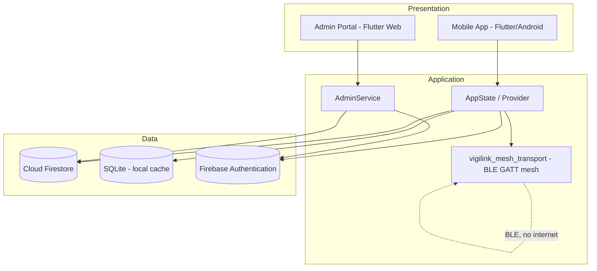

# 🛡️ VIGILINK

**Real-Time Vehicle Theft Monitoring and Alert System Using Ad Hoc Networks**

**CONNECT • DETECT • PROTECT**

## Overview

Theft alerts that depend entirely on internet or cellular coverage can fail
exactly when they're needed most — in areas with weak signal, during network
outages, or the moment a thief disables a vehicle's connected systems.
VIGILINK addresses this by sharing stolen-vehicle alerts directly between
nearby registered smartphones over Bluetooth Low Energy (BLE), with no
internet required for that path, while also delivering alerts through Cloud
Firestore to every signed-in user whenever internet is available.

**Objectives**
- Detect vehicle theft automatically (geofence violation) or by manual report.
- Deliver alerts to nearby registered users even with no internet connection,
  using a real BLE ad hoc mesh with multi-hop relay.
- Keep every registered user — owners, nearby users, and administrators —
  informed through a consistent alert history, system log, and admin portal.

**Target users:** vehicle owners/drivers, nearby registered users who may
relay or witness an alert, and the system administrator.

**Scope and limitations**
- Study area: Butuan City, Philippines.
- Covers four-wheel private vehicles only.
- Requires Android 10+ with Bluetooth LE and GPS.
- Smartphones act as the mobile ad hoc network nodes — there is no separate
  vehicle-mounted hardware; see §7 for what this means in practice.
- Offline (BLE) delivery only reaches registered devices within Bluetooth
  range of each other, directly or through relay.
- Not integrated with law-enforcement dispatch systems — the app surfaces
  local emergency hotline numbers for the user to call manually, it does not
  file a police report automatically.

---

## Main Features

- Registration with driver's license capture (front/back) and admin approval
  before an account can sign in.
- Vehicle registration — OR/CR photos, plate, make/color, engine and chassis
  numbers, multiple vehicles per owner.
- Geofence boundary per vehicle, with an "approaching boundary" warning
  before an actual violation.
- Manual stolen-vehicle report with exactly 3 photos, or an automatic report
  on geofence violation.
- Real BLE ad hoc mesh alert delivery with multi-hop relay (up to 5 hops).
- Store-carry-forward — a device relays an alert to a newly connected peer
  even if that happens much later, without needing everyone connected at once.
- A manual "Force Relay" action as an explicit fallback alongside the
  automatic relay.
- Cloud Firestore delivery to every signed-in user, with no distance limit,
  whenever internet is available.
- Alerts and the Firestore feed keep working while the app is backgrounded,
  via an Android foreground service.
- Sighting reports from nearby users back to the owner.
- Recovery updates with required proof photo and remarks.
- Alert history, delivery-delay logging, and a System Logs screen.
- A separate web Admin Portal for account/vehicle approval and monitoring.

---

## User Roles and Access Levels

| Role | What they can do |
|---|---|
| **Admin** (web portal) | Approve or reject new registrations; manage accounts and vehicles; view Live Activity; view the Map. Created by hand in the Firebase Console (a normal email/password account with `role: 'admin'` set on its Firestore document) — there is no in-app way to create or promote an admin. |
| **Registered user — vehicle owner** | Register vehicles, set a geofence, report a vehicle stolen (manually or automatically), update status/mark recovered, view their own alert history. |
| **Registered user — nearby user** | Receive alerts over BLE or Firestore, relay alerts onward, report a sighting of a flagged vehicle to its owner. |

Every account must verify its email (Google sign-in is exempt — Firebase
marks it verified automatically) and be approved by an admin before it can
sign in; a pending or rejected account is blocked at login.

---

## System Requirements

| Requirement | Detail |
|---|---|
| Mobile OS | Android 10+ (API 29+), with Bluetooth LE and GPS hardware |
| Flutter / Dart | Flutter with Dart SDK `>=3.6.0 <4.0.0` (see `pubspec.yaml`) |
| Backend | Firebase (Authentication, Cloud Firestore) |
| Admin Portal | Any modern desktop browser (Chrome recommended) |

---

## Installation and Setup

1. **Clone and fetch dependencies**
   ```bash
   git clone <repo-url>
   cd vehicleguard
   flutter pub get
   ```

2. **Firebase setup.** This project expects two config files that are
   intentionally **not committed** to version control (see `.gitignore`):
   `android/app/google-services.json` (Android) and `lib/firebase_options.dart`
   (generated by the FlutterFire CLI). Obtain your own copies from your
   Firebase project console / `flutterfire configure` and place them at those
   exact paths before building. TODO: confirm whether `lib/firebase_options_web.dart`
   (used by the Admin Portal web build) also needs to be supplied locally —
   it is present in version control in this repo, which is inconsistent with
   how the other two Firebase config files are handled; see the mismatch note
   at the end of this task.

3. **Run / build the mobile app**
   ```bash
   flutter devices              # list available devices
   flutter run                  # run on a connected Android device/emulator
   flutter build apk --release  # build the release APK
   # Output: build/app/outputs/flutter-apk/app-release.apk
   adb install build/app/outputs/flutter-apk/app-release.apk
   ```

4. **Build and run the Admin Portal** (a separate web-only entry point —
   it does not share `AppState` with the phone app)
   ```bash
   flutter build web -t lib/admin_main.dart
   # or, for local development:
   flutter run -d chrome -t lib/admin_main.dart
   ```

### Installing the Prebuilt APK on a Phone (no source build needed)

If you already have `app-release.apk` (built above, or shared to you directly)
and just want to install and run VIGILINK on an Android phone:

1. **Get the APK onto the phone.** Any of these work:
   - USB cable + `adb install build/app/outputs/flutter-apk/app-release.apk`
     (phone needs Developer Options → USB Debugging turned on first).
   - Transfer the file via USB file copy, email, or a cloud link (Drive,
     Messenger, etc.), then open it from the phone's Files/Downloads app.
2. **Allow installing from this source.** The first time, Android blocks it
   with *"For your security, your phone is not allowed to install unknown
   apps from this source."* Tap **Settings** on that prompt → toggle **Allow
   from this source** → go back and tap **Install** again.
3. **Wait for install to finish**, then tap **Open**, or find **VIGILINK** in
   the app drawer.
4. **Grant every permission requested on first launch** — Bluetooth,
   Location, and Notifications. All three must actually be granted (not just
   requested) for the ad hoc mesh and alerts to work at all; "While using the
   app" is enough for Location.
5. **Register or log in.** A new account needs driver's license photos and
   admin approval before it can sign in — see the User Manual below for the
   full registration steps. An already-approved account can log in right
   away.

---

**Permissions required on the phone**
- **Bluetooth** (scan/advertise/connect) — ad hoc mesh discovery and alert transfer.
- **Location** (fine + coarse) — required by Android alongside Bluetooth LE, and for geofencing/GPS tagging.
- **Notifications** — local alert/status notifications.
- **Foreground service** — keeps the mesh and Firestore alert feed running while the app is backgrounded.

**Troubleshooting**
- No nearby devices found: confirm Bluetooth **and** Location are both switched on for both phones.
- Alerts stop arriving after the app is backgrounded for a while: check the phone's battery-optimization settings and exempt VIGILINK — some Android OEM skins kill background services more aggressively than stock Android.
- Can't log in after registering: the account may still be pending admin approval, or the email-verification link hasn't been confirmed yet — check both.
- "Restart Scan" does nothing: confirm the app has all Bluetooth/location permissions actually granted (not just requested) in the phone's system settings.

---

## User Manual

1. **Register.** Open the app → Register → fill in details, capture driver's
   license front/back → submit → verify the emailed link → wait for admin
   approval.
   
2. **Log in / log out.** Log in with the verified, approved account; log out
   from the Profile screen.
   
3. **Navigate.** Bottom navigation: Home, Map, Alerts, Profile.
   
4. **Add/edit a vehicle.** From Home, add a vehicle with its plate,
   make/color, engine/chassis numbers, and OR/CR photos.
   
5. **Set a geofence.** Open a vehicle → Geofence → set the radius around its
   current/parked location.
   
6. **Report a stolen vehicle.** From Home → Report Stolen → attach 3 photos
   and notes → submit. (A geofence violation files this automatically.)
   
7. **Receive and relay an alert.** A nearby device shows "Stolen Vehicle
   Nearby" with a notification; it relays onward automatically, or via the
   manual Force Relay action.
   
8. **Report a sighting.** From an alert, open "Report a Sighting" to send a
   message/photo/location to the vehicle's owner.
   
9. **Mark a vehicle recovered.** From the alert, Update Status → attach the
   required recovery photo and remarks.
   
10. **View alert history and logs.** Alerts tab for history; Profile → System
    Logs for the full technical log.
    
11. **Admin Portal tasks.** Log in at the Admin Portal URL → Approvals tab to
    approve/reject registrations → Accounts/Vehicles tabs to manage records →
    Live Activity/Map to monitor in real time.
    

---

## System Design and Technical Details

### Architecture



### Main Data Entities

| Entity | Key fields | Notes |
|---|---|---|
| `UserModel` | `id`, `name`, `email`, `phone`, `role` (`owner`/`admin`), `deviceId`, `createdAt?` | Firestore `users/{uid}`; `approvalStatus`/`disabled` live only in Firestore |
| `VehicleModel` | `id`, `ownerId`, `plate`, `model`, `color`, `engineNumber`, `chassisNumber`, `status`, `geofenceRadius`, `geofenceCenterLat/Lng` | Firestore `users/{uid}/vehicles/{id}` |
| `TheftAlert` | `id`, `vehicleId`, `userId`, `plate`, `lat`/`lng`, `trigger`, `status`, `photos` (up to 3), `hopCount`, `relayedTo`, `recoveryPhotos`, `recoveryRemarks` | Firestore `theft_alerts/{id}` |
| `SightingReport` | `id`, `alertId`, `ownerId`, `reporterId`, `message`, `lat?`/`lng?`, `photoB64?` | Firestore `sightings/{id}` |
| `AdHocNode` | `id`, `name`, `isOnline`, `connectionType`, `relayStatus`, `endpointId` | Local-only (mesh status display) |

**Firestore collections in active use:** `users`, `vehicles`, `documents`
(license/OR/CR uploads), `license`, `theft_alerts`, `sightings`,
`alert_deliveries`, `location_history`, `presence`, `plates`,
`account_names`, `removed_accounts`.

### How Alerts Are Delivered

- **Direct BLE** — every phone runs a BLE GATT server (to receive) and opens
  a fresh BLE GATT client connection per send (to send); no separate radio or
  connection type is involved.
- **Multi-hop relay** — hop count starts at 0 on the original reporter's own
  device and increases by 1 at each real device that relays it, capped at 5
  hops; every device drops a duplicate it has already seen.
- **Store-carry-forward** — when no other device is in range yet, the alert
  is simply kept and relayed automatically the next time this device
  connects to a new peer.
- **Cloud Firestore** — delivered to every signed-in user with no distance
  limit, whenever that device has internet.
- **Offline-to-online sync** — any alert recorded while offline (by the
  reporter or a relay) uploads to Firestore automatically once that device
  regains internet.

### Key Technical Notes

- The BLE transport (`packages/vigilink_mesh_transport/`) is a local Flutter
  plugin: a presence/discovery beacon (advertise + scan) separate from the
  actual alert data path (BLE GATT server/client), plus an acknowledgment
  message so a successful radio write is never confused with confirmed
  delivery.
- Photos are never sent over BLE (too large for a reliable relay payload) —
  only the vehicle's text details travel the mesh, with a flag noting a
  photo exists. The real photo arrives later through Firestore once that
  device is back online.
- An Android foreground service keeps the mesh and the Firestore alert feed
  running while the app is backgrounded or its Activity is destroyed, for as
  long as the user stays logged in; it stops on logout.
- Geofence violation detection is location-based only, using the Haversine
  formula to compare a vehicle's current GPS fix against its saved geofence
  center and radius — there is no separate hardware vehicle tracker.
- **Broadcast radius** means the BLE signal range of each individual
  smartphone — it is not a fixed distance or something computed from GPS. It
  depends on the phone's own Bluetooth hardware and physical surroundings
  (walls, distance, interference). A reported alert's location comes from
  the reporting phone's own GPS fix (available even with no internet); each
  receiving phone then computes its own distance to that location using the
  Haversine formula.

### Project Structure

```
lib/
├── main.dart                              ← phone app entry point & routes
├── admin_main.dart                        ← separate web entry point (Admin Portal)
├── models/models.dart                     ← UserModel, VehicleModel, TheftAlert, etc.
├── services/
│   ├── app_state.dart                     ← main ChangeNotifier: auth, vehicles, alerts
│   ├── nearby_mesh_service.dart           ← Dart-facing mesh API
│   ├── alert_ingest.dart                  ← shared alert/sighting ingest, dedup, hop-count, relay
│   ├── mesh_background_service.dart       ← foreground-service TaskHandler
│   ├── admin_service.dart                 ← Admin Portal auth + account/vehicle management
│   ├── database_service.dart              ← local SQLite cache
│   ├── firebase_auth_service.dart         ← Firebase Authentication wrapper
│   ├── firebase_sync_service.dart         ← Firestore reads/writes/live listeners
│   ├── location_service.dart              ← GPS wrapper, Haversine distance
│   ├── connectivity_service.dart          ← online/offline detection
│   └── notification_service.dart          ← local notifications
├── utils/                                 ← theme, validators, time format, hotlines, etc.
├── widgets/                                ← shared UI components
└── screens/
    ├── s1_splash_screen.dart
    ├── s2_s3_auth_screens.dart            ← Register, Login
    ├── s4_s5_vehicle_home.dart            ← Register Vehicle, Home
    ├── s6_s7_s8_geofence_report.dart      ← Geofence, Report Stolen, Alert Broadcasting
    ├── s9_s10_s11_alerts_map.dart         ← Alert Received, Proximity Map, Alert History
    ├── s12_s13_s14_status_notif_profile.dart ← Update Status, Notifications, Profile, System Logs
    ├── s16_sightings.dart                 ← report/review sightings
    ├── s18_license_verification.dart      ← driver's license capture
    ├── onboarding_screen.dart
    └── admin/                             ← Admin Portal screens

packages/vigilink_mesh_transport/          ← local plugin: real BLE GATT mesh (Dart API + native Kotlin)
```

### Key Dependencies

| Package | Purpose |
|---|---|
| `provider` | State management (`AppState` / `ChangeNotifier`) |
| `firebase_auth` / `cloud_firestore` / `firebase_core` | Accounts, cloud database, cloud sync |
| `firebase_messaging` | Push notification receipt |
| `vigilink_mesh_transport` (local plugin) | Real BLE ad hoc mesh — discovery and data transfer, zero internet dependency |
| `flutter_foreground_task` | Keeps the mesh and Firestore feed running while backgrounded |
| `flutter_local_notifications` | Real local device notifications |
| `geolocator` | GPS location for geofencing and alert tagging |
| `permission_handler` | Bluetooth, location, and notification permission requests |
| `sqflite` | Local offline-first storage |
| `image_picker` | Camera/gallery capture for licenses, OR/CR, and report photos |
| `connectivity_plus` | Network connectivity detection |
| `google_sign_in` | "Continue with Google" sign-in |
| `flutter_map` / `latlong2` | Proximity map display |
| `shared_preferences` | Small local settings |

---

## Evaluation

- **Functional testing:** 13 test cases, all passed.
- **Performance:** notification delay, successful alert transmission rate,
  and multi-hop dissemination were measured during real multi-device
  testing.
- **Usability (System Usability Scale):** 70 respondents, mean score 85.0
  ("Best Imaginable").

---

*Capstone Project — BS Information Technology*
*College of Computing and Information Sciences (CCIS)*
*Caraga State University — Main Campus*
*SY 2025–2026*
