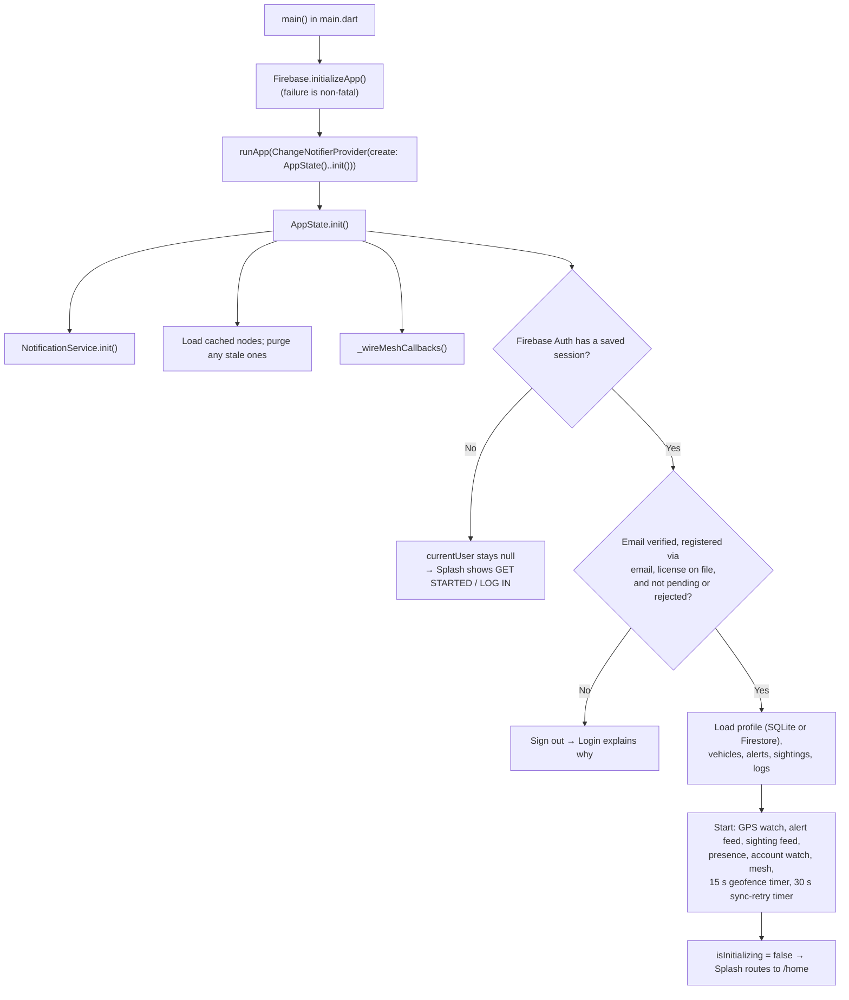
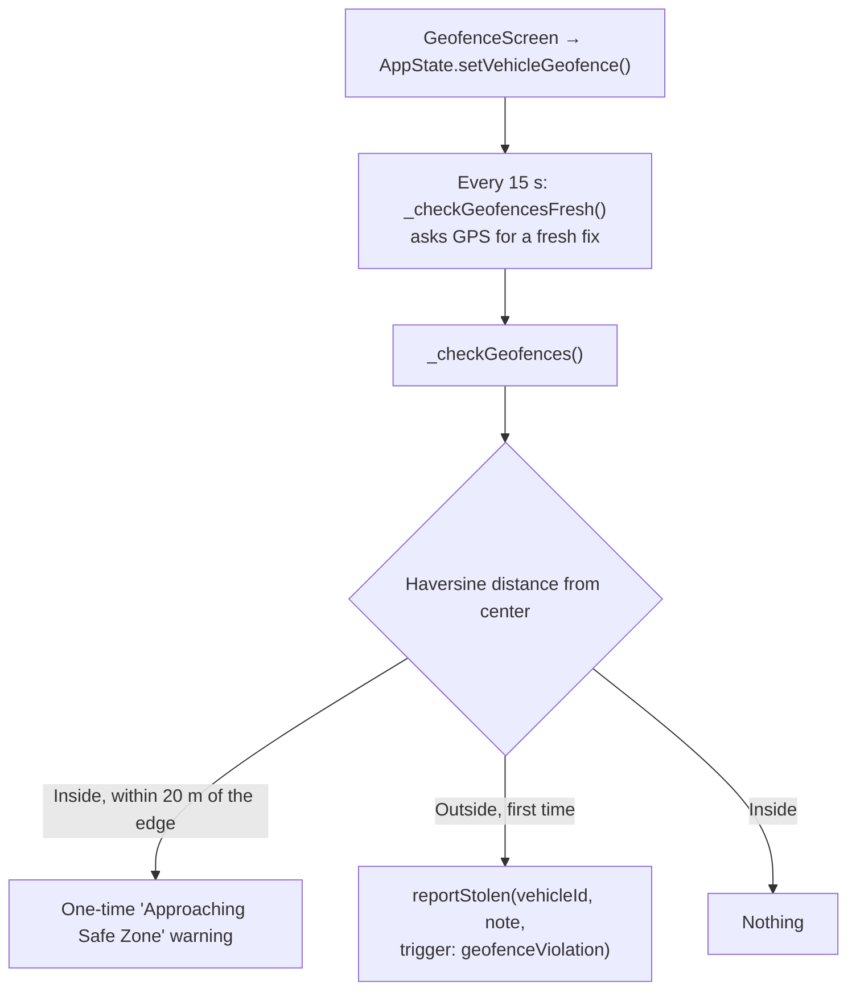
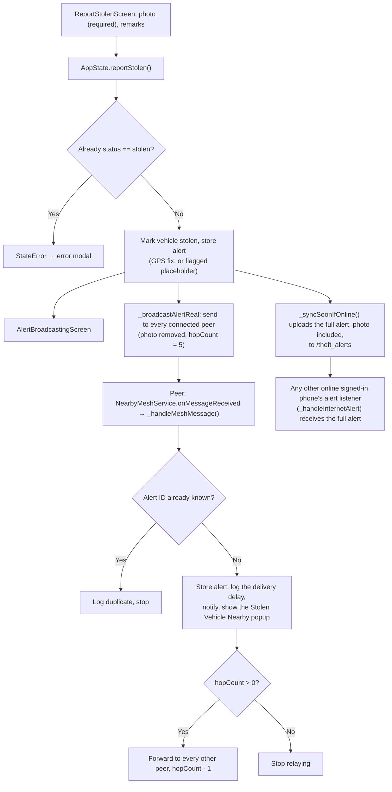
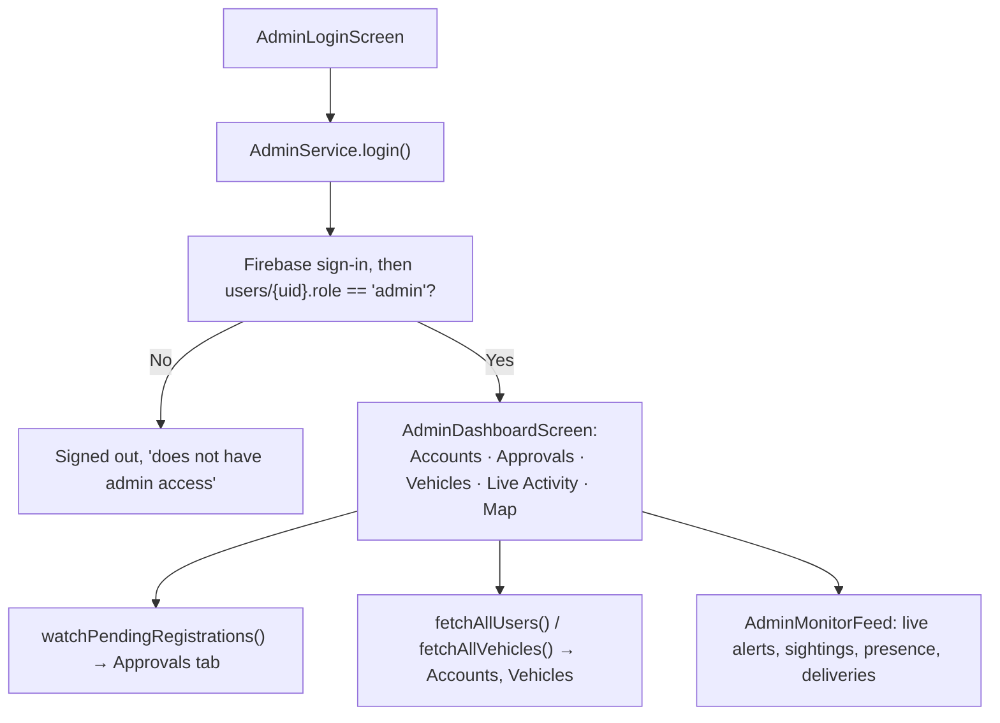
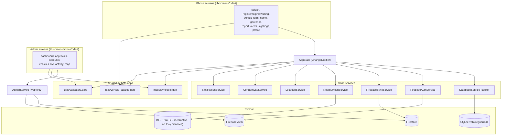

# VehicleGuard — Developer & Defense Study Guide (REVIEWER.md)

**Real-Time Vehicle Theft Monitoring and Alert System Using Ad Hoc Networks**
Caraga State University · Cindy A. Francas & Cedric Michael Uy

This guide describes the code as it is in this repository. Every claim was
checked against the source files. Where the manuscript and the code differ,
the guide says so.

---

## TABLE OF CONTENTS

1. [System Overview](#1-system-overview)
2. [Folder & File Structure](#2-folder--file-structure)
3. [How the System Works (Flow)](#3-how-the-system-works-flow)
4. [File-by-File Breakdown](#4-file-by-file-breakdown)
5. [Code-to-Code Connections](#5-code-to-code-connections)
6. [Data Layer](#6-data-layer)
7. [Key Algorithms & Logic](#7-key-algorithms--logic)
8. [Possible Defense Questions](#8-possible-defense-questions)
9. [Known Weaknesses / Limitations](#9-known-weaknesses--limitations)

---

## 1. SYSTEM OVERVIEW

### 1.1 What the system does

VehicleGuard is an Android app, plus a separate browser-only Admin Portal.

1. **Registration.** A person creates an account with email and password,
   photographs both sides of a driver's license, and enters one vehicle on the
   same page. They enter the plate, vehicle type, color, series and year model
   by hand (with dropdowns or search where they help). They photograph the
   vehicle's Official Receipt (OR) and Certificate of Registration (CR). Nothing
   is read from the photos automatically.
2. **Admin approval.** The registration is submitted as *pending*. An admin
   checks the license and OR/CR photos on the Admin Dashboard and approves or
   rejects. Only an approved account can sign in. A rejection shows the reason
   and lets the person register again.
3. **Geofence.** The owner sets a safe zone around the vehicle. If the phone
   (standing in for the vehicle) leaves that zone, a theft report is created
   automatically.
4. **Manual report.** The owner can report a vehicle stolen at any time, with a
   required photo and optional remarks. A vehicle can only have one active
   report at a time, until it is marked recovered.
5. **Broadcast.** The alert goes to nearby VehicleGuard phones over a real
   ad hoc mesh — raw BLE advertise/scan for discovery and native Wi-Fi Direct
   (`WifiP2pManager`) for the connection and data transfer, with no Google
   Play Services involved anywhere in that path, so it needs no internet at
   all. It also goes to Firestore, with no distance limit, so any signed-in
   phone that's online receives it regardless of range. Each alert carries a
   hop-count limit, and every phone that receives it relays it onward
   (multi-hop store-and-forward). An Android foreground service keeps both
   paths running while the app is backgrounded or its Activity is destroyed,
   not just while it's open.
6. **Sightings.** Anyone who sees a flagged car can send a sighting (message,
   optional photo and GPS) to the owner, over the same two paths.
7. **Delivery delay.** Each phone that receives an alert records how long after
   it was sent it arrived, and by which route and hop count. These records reach
   the Admin Dashboard, which shows an average.
8. **Admin Dashboard** (web only, a separate build). Admins review pending
   registrations, manage accounts (suspend, restore, remove, add), view vehicles
   and their OR/CR, follow a live activity feed and a map.

### 1.2 Tech stack (from `pubspec.yaml`)

| Package | Version | Used for |
|---|---|---|
| `flutter` (SDK) | Dart ≥3.6.0 | UI framework |
| `provider` | ^6.1.1 | App-wide state (`AppState` is a `ChangeNotifier`) |
| `firebase_core` | ^3.6.0 | Firebase bootstrap, both app targets |
| `firebase_auth` | ^5.3.1 | Email/password sign-in, email verification, password reset |
| `google_sign_in` | ^6.2.1 | "Continue with Google" for already-registered accounts |
| `cloud_firestore` | ^5.4.4 | Cloud database: profiles, vehicles, alerts, sightings, approvals |
| `firebase_messaging` | ^15.1.3 | Receives FCM pushes (receive side only, see §9) |
| `vigilink_mesh_transport` | local (`packages/`) | The real ad hoc mesh — raw BLE advertise/scan + native Wi-Fi Direct, no Play Services |
| `flutter_foreground_task` | ^9.1.0 | Android foreground service — keeps the mesh/Firestore feeds running when backgrounded |
| `sqflite` + `path` | ^2.3.3+1 / ^1.9.0 | Local SQLite cache (offline-first) |
| `shared_preferences` | ^2.2.2 | Small flags: login lockout counters, license-on-file cache, profile photo |
| `geolocator` | ^11.0.0 | GPS position and Haversine distance |
| `permission_handler` | ^11.3.0 | Runtime permissions (Bluetooth, location, Nearby Wi-Fi, notifications) |
| `connectivity_plus` | ^6.0.5 | Online/offline detection, drives sync |
| `flutter_local_notifications` | ^17.1.2 | Local Android notifications |
| `image_picker` | ^1.1.2 | Camera/gallery for license, OR/CR and evidence photos |
| `flutter_map` + `latlong2` | ^8.3.0 / ^0.9.1 | OpenStreetMap maps (owner and admin) |
| `google_fonts` | ^6.1.0 | DM Sans / DM Mono typography |
| `flutter_animate` | ^4.5.0 | Animations |
| `intl` | ^0.19.0 | Date formatting |

Dev only: `flutter_test`, `flutter_lints` (^3.0.0).

There is no backend server code in this repository. Firebase (Authentication
and Firestore) is the backend, called directly from the clients. There is no
Cloud Functions project.

### 1.3 Architecture pattern

**Provider with one `ChangeNotifier`, `AppState`.** It is not MVC, Bloc,
Riverpod or GetX.

- `AppState` (`lib/services/app_state.dart`, about 2,900 lines) is registered
  once in `main.dart`:
  ```dart
  ChangeNotifierProvider(create: (_) => AppState()..init(), child: const VehicleGuardApp())
  ```
  Screens read it with `context.watch<AppState>()` to rebuild, or
  `context.read<AppState>()` to call a method. Each mutation ends with
  `notifyListeners()`.
- Below `AppState` are singleton services (`DatabaseService.instance`,
  `NearbyMeshService.instance`, `FirebaseSyncService.instance`, and so on).
  Each wraps one concern. `AppState` is the only class that coordinates several
  of them.
- The Admin Portal is independent. It has its own entry point
  (`lib/admin_main.dart`), never imports `AppState` or `DatabaseService`
  (sqflite has no web implementation), and talks to Firestore through
  `AdminService`. The two apps share only `models/models.dart` and
  `utils/validators.dart`.

**Why this fits the project:** one state object is easy to follow and demo.
Every screen updates from one `notifyListeners()` call. No code generation or
extra packages are needed. It keeps "what the app knows" (`AppState`'s fields)
separate from "how it knows it" (the services). The manuscript's two delivery
paths (mesh and internet) and two storage layers (SQLite and Firestore) need
exactly that separation.

---

## 2. FOLDER & FILE STRUCTURE

```
vehicleguard/
├── android/                              Native Android project
│   └── app/
│       ├── build.gradle.kts              Release build config
│       ├── google-services.json          Firebase config for the phone app
│       └── src/main/AndroidManifest.xml  Permissions: Bluetooth, Wi-Fi, location, camera, notifications
├── lib/
│   ├── main.dart                         PHONE entry point: routes, theme, incoming-alert popups
│   ├── admin_main.dart                   WEB Admin Portal entry point (separate build target)
│   ├── firebase_options_web.dart         Firebase config for the web admin build
│   │
│   ├── models/
│   │   └── models.dart                   Data classes and enums (see §6)
│   │
│   ├── services/                         Business logic and integrations
│   │   ├── app_state.dart                Central ChangeNotifier that coordinates everything
│   │   ├── database_service.dart         Local SQLite cache (schema v8)
│   │   ├── firebase_auth_service.dart    Firebase Authentication wrapper
│   │   ├── firebase_sync_service.dart    Firestore reads, writes and live listeners
│   │   ├── nearby_mesh_service.dart      Ad hoc mesh (raw BLE + native Wi-Fi Direct)
│   │   ├── alert_ingest.dart             Shared alert/sighting ingest logic (foreground + background)
│   │   ├── mesh_background_service.dart  Foreground-service TaskHandler (mesh + Firestore feeds backgrounded)
│   │   ├── location_service.dart         GPS wrapper and Haversine distance
│   │   ├── connectivity_service.dart     Online/offline detection
│   │   ├── notification_service.dart     Local notifications and FCM receive side
│   │   └── admin_service.dart            Web Admin Portal logic (Firestore only)
│   │
│   ├── utils/
│   │   ├── app_theme.dart                AppColors and the ThemeData
│   │   ├── validators.dart               Phone, email, plate and full-name checks and normalization
│   │   ├── vehicle_catalog.dart          Body types, makes/models and colors for the pickers
│   │   ├── geo_defaults.dart             Fallback coordinates (Butuan City)
│   │   └── time_format.dart              "5m ago" relative time
│   │
│   ├── widgets/
│   │   ├── widgets.dart                  Shared UI: dialogs, cards, buttons, pickers, vehicle card, photo viewer
│   │   ├── document_photo.dart           Camera/gallery sheet, photo capture, DocumentPhotoCard
│   │   └── terms_and_conditions.dart     Terms & Conditions / Privacy gate before registration
│   │
│   └── screens/                          Phone screens, grouped by lo-fi prototype number
│       ├── s1_splash_screen.dart             Screen 1: splash, auto-route if signed in
│       ├── s2_s3_auth_screens.dart           Screens 2–3: Register (with vehicle), Awaiting Approval,
│       │                                     Email Verification, Login
│       ├── s4_s5_vehicle_home.dart           Screens 4–5: Vehicle form (shared), Add Vehicle, Home
│       ├── s6_s7_s8_geofence_report.dart     Screens 6–8: Geofence, Report Stolen, Broadcasting
│       ├── s9_s10_s11_alerts_map.dart        Screens 9–11: Alert Received, Proximity Map, Alert History
│       ├── s12_s13_s14_status_notif_profile.dart  Screens 12–14: Update Status, Notifications, Profile, System Logs
│       ├── s16_sightings.dart                Screen 16: Report a Sighting, a vehicle's Sightings
│       ├── s18_license_verification.dart     Screen 18: license photo capture, login-time license gate
│       │
│       └── admin/                        WEB-ONLY Admin Portal
│           ├── admin_dashboard.dart          Admin login, dashboard shell, tabs, Add User
│           ├── admin_approvals.dart          Approvals tab: review and decide pending registrations
│           ├── admin_accounts.dart           Accounts tab: list, detail, suspend/restore/remove
│           ├── admin_vehicles.dart           Vehicles tab: list, OR/CR viewer
│           ├── admin_monitoring.dart         Live Activity tab (feed, delivery log) and Map tab
│           └── admin_widgets.dart            Shared admin UI and registration-order numbering
│
├── test/
│   ├── admin_accounts_test.dart          Accounts tab layout and registration-order regression
│   ├── admin_widgets_test.dart           registrationNumbers() ordering
│   ├── models_test.dart                  Model toMap/fromMap round-trips
│   ├── validators_test.dart              Phone, email and plate validators
│   └── widget_test.dart                  Splash screen smoke test
│
├── pubspec.yaml                          Package manifest (no assets section)
└── Progress.md                           Development changelog (not part of the app)
```

### One-line purpose of each file

| File | Purpose |
|---|---|
| `lib/main.dart` | Boots Firebase, creates `AppState`, defines every named route, shows incoming-alert, geofence-warning and account-disabled dialogs app-wide |
| `lib/admin_main.dart` | Boots Firebase for the web build; routes to Admin Login and the dashboard |
| `lib/firebase_options_web.dart` | Firebase project settings for the web admin build |
| `lib/models/models.dart` | Every data class and enum shared by the app and the admin build |
| `lib/services/app_state.dart` | Auth, registration submission, approval gate, vehicles, geofences, alerts, sightings, the mesh, presence, sync, notifications, logs |
| `lib/services/database_service.dart` | Opens and migrates the SQLite database; CRUD for every local table |
| `lib/services/firebase_auth_service.dart` | Account creation, sign-in, Google sign-in, email verification, password reset, account deletion |
| `lib/services/firebase_sync_service.dart` | Firestore: profile upload, approval status, vehicles and OR/CR, plates and name registries, alerts, sightings, presence, license, delivery log, live feeds |
| `lib/services/nearby_mesh_service.dart` | Starts and stops advertising and discovery; connects, sends and broadcasts JSON payloads |
| `lib/services/location_service.dart` | GPS wrapper; never fabricates coordinates; Haversine distance |
| `lib/services/connectivity_service.dart` | Streams online/offline changes |
| `lib/services/notification_service.dart` | Shows local notifications; receives FCM messages |
| `lib/services/admin_service.dart` | Admin login gate, account and vehicle reads, live monitoring streams, approval decisions, suspend/remove/create account, alert delivery stream |
| `lib/utils/app_theme.dart` | `AppColors` and the app `ThemeData` |
| `lib/utils/validators.dart` | Phone and email validation; plate and full-name normalization |
| `lib/utils/vehicle_catalog.dart` | Body types, models for each body type, colors |
| `lib/utils/geo_defaults.dart` | Fallback coordinates, Butuan City |
| `lib/utils/time_format.dart` | `timeAgo()` |
| `lib/widgets/widgets.dart` | Dialogs, cards, buttons, `SearchableSelectField`, `VehicleCard`, `showPhotoViewer` and other shared widgets |
| `lib/widgets/document_photo.dart` | `showImageSourceSheet`, `captureDocumentPhoto` (resize and size cap), `DocumentPhotoCard` |
| `lib/widgets/terms_and_conditions.dart` | Terms and Privacy modal |
| `lib/screens/s1_splash_screen.dart` | Landing screen; sends a signed-in user to Home |
| `lib/screens/s2_s3_auth_screens.dart` | `RegisterScreen` (account + license + vehicle), `AwaitingApprovalScreen`, `_EmailVerificationScreen`, `LoginScreen` |
| `lib/screens/s4_s5_vehicle_home.dart` | `VehicleFormSection` (shared form), `RegisterVehicleScreen` (Add Vehicle), `HomeScreen` |
| `lib/screens/s6_s7_s8_geofence_report.dart` | `GeofenceScreen`, `ReportStolenScreen`, `AlertBroadcastingScreen` |
| `lib/screens/s9_s10_s11_alerts_map.dart` | `AlertReceivedScreen`, `ProximityMapScreen`, `AlertHistoryScreen`, `BottomNavBar` |
| `lib/screens/s12_s13_s14_status_notif_profile.dart` | `UpdateStatusScreen`, `NotificationsScreen`, `ProfileScreen`, `SystemLogsScreen` |
| `lib/screens/s16_sightings.dart` | `ReportSightingScreen`, `AlertSightingsScreen` |
| `lib/screens/s18_license_verification.dart` | `LicenseCaptureSection` (used by registration and login), `LicenseVerificationScreen` |
| `lib/screens/admin/admin_dashboard.dart` | Admin login and the dashboard shell with its five tabs |
| `lib/screens/admin/admin_approvals.dart` | `ApprovalsTab` and its cards: documents, verification checklist, approve/reject |
| `lib/screens/admin/admin_accounts.dart` | `AccountsTab` and the account detail sheet |
| `lib/screens/admin/admin_vehicles.dart` | `VehiclesTab` and the vehicle detail sheet |
| `lib/screens/admin/admin_monitoring.dart` | `LiveActivityTab` (activity feed, delivery log), alert detail sheet, `MonitorMapTab` |
| `lib/screens/admin/admin_widgets.dart` | `byRegistrationOrder`, `registrationNumbers`, `AdminStatChip`, `AdminInfoCard`, `AdminPhotoTile` and other shared admin widgets |

---

## 3. HOW THE SYSTEM WORKS (FLOW)

### 3.1 App startup



### 3.2 Registration and approval

1. **Splash** → **GET STARTED** → Terms and Privacy must be accepted → **RegisterScreen**.
2. The person fills in name, email, mobile number and password. Password strength
   is shown live. They take the front and back of the driver's license
   (`LicenseCaptureSection`). They fill in the **VEHICLE** section below, which is
   the shared `VehicleFormSection` in `embedded` mode (no save button of its own).
   They take the OR and CR photos, and type or pick the plate, type, color,
   series and year model.
3. **REGISTER** → `RegisterScreen._submit()`:
   - `collectDraft()` on the vehicle section checks that both OR/CR photos exist
     and that the form is valid. It returns a `VehicleDraft`.
   - `AppState.submitRegistration(...)` runs (see §4.3):
     create the sign-in → check the full name → claim the plate → upload the
     OR/CR photos and the vehicle record → upload the license photos → write the
     profile as `approvalStatus: 'pending'` → claim the full name.
   - Any failure rolls back everything created so far.
4. On success, a **Registration Submitted** modal explains that an admin must
   approve the account. The person then goes to **AwaitingApprovalScreen**
   (`/awaiting-approval`). This screen listens to the account's status live.
   Back is disabled on this screen.
5. **Admin decision** (Admin Dashboard → Approvals):
   - **Approve** (enabled only after all four documents are ticked as genuine and
     unedited, and all four photos exist): `approveRegistration` sets
     `approvalStatus: 'approved'`.
   - **Reject** (asks for a reason): `rejectRegistration` deletes the vehicle(s),
     their OR/CR photos, the license photos, the plate claims and the name claim.
     It then sets `approvalStatus: 'rejected'` with the reason.
6. **Awaiting screen reacts live:**
   - *Approved* → `completeApprovedSignIn()`. If the email is verified, the
     person is signed in and sent to Home. If not, they are signed out and told to
     verify the email first.
   - *Rejected* → the reason is shown, then `discardRejectedRegistration()` deletes
     the sign-in so the email is free, and the person goes back to Register. If
     Firebase refuses the delete (a long-open session), the person is asked to
     log in once more.
7. **Logging in later:**
   - `login()` checks the password, then email verification, then the disabled
     flag, then `_approvalGate`. A *pending* account is signed out with an
     "awaiting approval" notice. A *rejected* account sees the reason, and then
     the registration is discarded.
   - Accounts with no approval field (everything from before this change) count
     as approved.

### 3.3 Geofence → automatic theft report



### 3.4 Manual report → broadcast → multi-hop relay



### 3.5 Sightings

`AppState.submitSighting()` saves the sighting locally first. It uploads the full
sighting, photo and phone number, to `/sightings`. If mesh peers are connected, it
also broadcasts a text-only copy with a 5-hop limit. A receiving phone keeps a
sighting only if it is the vehicle owner's, otherwise (mesh path) it relays the
text onward.

### 3.6 Admin Portal



---

## 4. FILE-BY-FILE BREAKDOWN

### 4.1 `lib/main.dart`

**Purpose:** Firebase bootstrap, the `MaterialApp`, and the route table.

**Classes:**
- `VehicleGuardApp` — builds the `MaterialApp` with `onGenerateRoute` (`_generateRoute`) and a slide, fade and scale page transition (`_slide`).
- `_IncomingAlertWatcher` — wraps every screen through `MaterialApp.builder`. It shows the **Stolen Vehicle Nearby** popup, the **Approaching Safe Zone** warning and the **Account Disabled** notice. It uses sequence counters from `AppState` (`incomingAlertSeq`, `geofenceNearWarningSeq`, `accountDisabledSeq`): an event is shown once, and a new event is shown even if its text is the same as before.

**Routes (`_generateRoute`):** `/` splash, `/register`, `/login`, `/home`,
`/register-vehicle` (Add Vehicle), `/awaiting-approval`, `/geofence` (argument:
`VehicleModel`), `/report` (`VehicleModel`), `/broadcasting` (`TheftAlert`),
`/alert-received` (`TheftAlert`), `/report-sighting` (`TheftAlert`),
`/alert-sightings` (`TheftAlert`), `/prox-map`, `/alert-history`,
`/update-status` (`TheftAlert`), `/notifications`, `/profile`, `/logs`. Any
unknown name goes to the splash screen.

**Key functions:**
| Function | Behavior |
|---|---|
| `main()` | Sets orientation and status bar style. Calls `Firebase.initializeApp()` in a try block, so a failure does not stop the app. Starts `AppState()..init()` under the provider |
| `_generateRoute(RouteSettings)` | Switches on the route name and pulls typed arguments out of `settings.arguments` |
| `_showAlert(TheftAlert)` | "Stolen Vehicle Nearby!" confirm dialog. **View Details** pushes `/alert-received` |
| `_showGeofenceWarning(VehicleModel, double)` | Near-boundary warning with a single "Got It" button |
| `_showAccountDisabled()` | One-button notice, then routes to `/login` and clears the stack |

### 4.2 `lib/models/models.dart`

**Purpose:** every plain-Dart type shared by the app and the admin build. It
imports no Flutter or Firebase packages (except `dart:typed_data`).

Each persisted model has the same three-part shape:
```dart
Map<String, Object?> toMap() => {...};                // the SQLite row and the Firestore document
factory X.fromMap(Map<String, Object?> m) => X(...);  // defensive: falls back instead of throwing
```
One malformed document can't crash a list, because every field has a fallback.

| Type | Fields | Notes |
|---|---|---|
| `GpsStatus`, `NetworkStatus` | enums with `label` getters | GPS and sync indicators |
| `RegistrationDecision` | `pending`, `rejected` | Why a sign-in was stopped (login screen) |
| `VehicleDraft` | `plate`, `model` (the Series), `color`, `type`, `yearModel`, `geofence`, `orPhoto`, `crPhoto` | What the registration form collects, before anything is saved |
| `UserModel` | `id` (Firebase UID), `name`, `email`, `phone`, `role` (`owner`/`admin`), `deviceId`, `createdAt?`; `initials` is derived | Profile. `approvalStatus`, `rejectionReason` and `disabled` live only in Firestore, not on the model |
| `VehicleModel` | `id`, `ownerId`, `plate`, `model`, `color`, `type`, `yearModel`, `status` (`active`/`stolen`/`recovered`), `geofenceRadius`, `geofenceActive`, `geofenceCenterLat/Lng`, `deviceId`, `lat`, `lng`, `lastLocationUpdate`, `createdAt?` | `statusLabel`: NOT STOLEN / STOLEN / RECOVERED |
| `TheftAlert` | `id` (`ALT-{deviceId}-{epochMs}`), `vehicleId`, `userId`, `plate`, `model`, `color`, `lat`, `lng`, `timestamp` (the sent time), `trigger` (`manualReport`/`geofenceViolation`), `status` (`active`/`recovered`/`resolved`), `notes`, `photoB64?`, `hopCount`, `relayedTo`, `isDemoLocation` | `hasPhoto` getter |
| `SightingReport` | `id`, `alertId`, `ownerId`, `reporterId`, `reporterName`, `reporterPhone`, `message`, `lat?`, `lng?`, `seenAt`, `sentAt`, `photoB64?` | `forMesh()` drops photo and phone. `hasLocation`, `hasPhoto`, `hasContact` |
| `SightingSubmitResult` | `delivered`, `sharedOverMesh`, `blockedByRules`, `error?` | Tells "queued" apart from "refused by the rules" |
| `AdHocNode` | `id`, `name`, `distance`, `isOnline`, `connectionType` (`wifiDirect`/`ble`), `hopCount`, `relayStatus`, `mapX`, `mapY`, `isSimulated`, `endpointId?`, `viaInternet` | One peer, or an internet-presence entry. Never saved for internet presence |
| `LocationRecord` | `dbId?`, `vehicleId`, `lat`, `lng`, `time`, `synced` | One GPS point recorded at each report |
| `SystemLog` | `timestamp` (HH:mm:ss), `tag`, `message`, `type` (`ok`/`warn`/`err`/`info`/`relay`) | Diagnostic trail |
| `NotifItem` | `id`, `title`, `body`, `type`, `time`, `isRead` | In-app notifications |

Types defined elsewhere: `AlertDelivery` and `AdminUserRow` are in
`admin_service.dart`, and `PendingRegistration` is a typedef in the same file.

### 4.3 `lib/services/app_state.dart` — the central coordinator

**Purpose:** owns the in-memory lists (`_vehicles`, `_alerts`, `_sightings`,
`nodes`, `notifications`, `logs`, `locationHistory`), mirrors them to SQLite, and
coordinates every service. Organized into commented sections.

**Public state (read by screens):** `isInitializing`, `currentUser`,
`isLoggedIn`, `myVehicles`, `activeAlerts`, `allAlerts`, `myAlerts`,
`sightingsForAlert(id)`, `nodes`, `meshActive`, `meshStatusLabel`,
`connectedPeerCount`, `discoveredPeerCount`, `notifications`, `logs`,
`gpsStatus`, `currentLat/Lng`, `networkStatus`, `totalRelayed`, `alertDelay`,
`transmissionRate`, `receivedVia` (alert ID → "Ad Hoc Mesh" or "Internet"),
`lastAuthError`, `pendingEmailVerification`, `pendingLicense`,
`registrationDecision`, `rejectionReason`, `monitoringArmed`, `profilePhotoBytes`,
`incomingAlert`, `incomingAlertSeq`, `geofenceNearWarningVehicle`,
`geofenceNearWarningSeq`, `accountDisabledSeq`, `googleRejectedEmail`,
`pendingRegistrationEmail`.

**Functions, grouped by section:**

*Startup and lifecycle*
| Function | Purpose |
|---|---|
| `init()` | Loads preferences, nodes, and the saved session. Session restore signs out an unverified, non-password, unlicensed, pending or rejected account (see `_approvalBlocksSession`). Starts GPS, the geofence and sync timers, and the live feeds |
| `didChangeAppLifecycleState` / `_onAppResumed()` | On resume: sync, restart feeds. Restarts the mesh only after more than 20 seconds away with nothing connected |

*Real ad hoc mesh*
| Function | Purpose |
|---|---|
| `_wireMeshCallbacks()` | Connects every `NearbyMeshService` event to node lists, logs and notifications. On peer connect, sends that peer every active alert (store-carry-forward) |
| `_startMeshIfNeeded()` / `_startMesh()` / `restartMesh({quiet})` / `requestMeshPermissions()` | Start-up, with one shared in-flight attempt, so overlapping calls cannot cause `STATUS_ALREADY_ADVERTISING` |
| `_handleMeshMessage(msg, fromEndpointId)` | The relay core, by `msgType`. **`theft_alert`:** dedupe by ID (memory, then SQLite, then re-checked at insert), store, log the delivery delay (`_logAlertDelivery`), notify, forward to every other peer with `hopCount - 1`. **`status_update`:** applies a recovery, with a range check on the status index. **`sighting`:** `_handleMeshSighting` |
| `_broadcastAlertReal(alert)` | Send the alert over the real mesh. Record `relayedTo` and timings |
| `_alertWireMessage(alert)` | Alert JSON with `msgType`, `hopCount = 5`, `hasPhotoEvidence`, and **without** `photoB64` (too big for a relay payload) |

*Delivery delay*
| Function | Purpose |
|---|---|
| `_hms(DateTime)` | `HH:mm:ss.mmm`, millisecond precision |
| `_logAlertDelivery(alert, {via})` | Called once, from the two places a genuinely new alert is stored (mesh and internet). It computes `delay = now − alert.timestamp`. It writes a System Log line with tag `DELAY`, `ALERT {plate} · sent … · received … · delay N.NNs · via … · hop N`, and sends the same record to `/alert_deliveries` (`FirebaseSyncService.logAlertDelivery`) |

*Sightings*
| Function | Purpose |
|---|---|
| `submitSighting({alert, message, seenAt, lat?, lng?, photoBytes?})` | Message 5–500 characters; photo at most 500 KB. Saves locally, uploads, and broadcasts a text-only mesh copy (5-hop limit) |
| `_handleMeshSighting` / `_handleInternetSighting` / `_storeReceivedSighting` | Keeps a sighting only for the vehicle owner. Upgrades a text-only copy once the full cloud copy (with photo and phone) arrives |

*Internet alert feed and account watch*
| Function | Purpose |
|---|---|
| `_handleInternetAlert(data)` | Ignores its own alerts. Only raises a brand-new *active* alert — no distance filter, any logged-in online user gets it regardless of range. Applies a newer status to an alert already known |
| `_startAccountWatch()` / `_forceLogoutDisabled()` | Watches this account's disabled and removed flags. Signs out live if an admin suspends it |

*Presence ("nearby devices" by shared GPS)*
| Function | Purpose |
|---|---|
| `_startPresence()` / `_presenceTick()` / `_stopPresence()` / `_recomputePresenceNodes()` | Every 30 s, while foregrounded and online, publishes the phone's position (rounded to about 11 m) to `/presence/{uid}`. Lists other signed-in phones within 100 m as `viaInternet` nodes, skipping any already connected over Bluetooth |

*Registration and sign-in*
| Function | Purpose |
|---|---|
| `submitRegistration({name, email, phone, password, licenseFront, licenseBack, vehicle})` → `String?` | Full registration (see below). Returns `null` on success, or a user-facing message |
| `_approvalGate(uid)` → `bool` | Used by email login and Google sign-in. Pending: signs out, sets `registrationDecision = pending`. Rejected: keeps the session, sets `registrationDecision` and `rejectionReason`. Unreadable status: signs out (fails closed). Approved or missing: continues |
| `_approvalBlocksSession(uid)` → `bool` | Used at session restore. Blocks only a pending or rejected status. An unreadable status lets the session through, so approved accounts still open offline |
| `login(email, password)` → `bool` | Checks the lockout (5 attempts, 5 minutes, persisted). Signs in, then checks email verification, the disabled flag, `_approvalGate`, and the license (`_licenseGate`). Then `_completeSignIn` |
| `completeApprovedSignIn()` → `bool` | Used by the Awaiting screen after an approval. Needs a verified email and a readable profile. Then `_completeSignIn` |
| `discardRejectedRegistration()` → `bool` | Deletes the sign-in created for a rejected registration, freeing the email. Returns `false` when Firebase refuses the delete |
| `leaveAwaitingApproval()` | Signs out of the Awaiting screen. The account stays pending |
| `watchOwnApproval()` → `Stream?` | The current account's approval status, live. Null when nobody is signed in |
| `signInWithGoogle()` → `bool` | Refuses a Google account that was never registered through the app (`isRegisteredAccount`), then disabled check, then `_approvalGate`, then license, then `_completeSignIn` |
| `_completeSignIn(profile, {logMessage})` | Caches the profile, syncs vehicles from the cloud (bounded to 10 s), loads data, loads the profile photo, starts the feeds and presence, and starts the account watch |
| `submitLicense({front, back})` | Uploads the two license photos. Used by the login-time license screen |
| `completePendingSignIn()` / `cancelPendingSignIn()` | Finish or abandon a sign-in that was waiting for the license |
| `sendPasswordResetEmail`, `resendVerificationEmail`, `checkEmailVerified` | Thin passthroughs to `FirebaseAuthService` |
| `logout()` | Clears session, feeds, mesh, presence and in-memory data |
| `updateProfile({name, phone, currentPassword?})` | Changing the phone number needs the current password (re-authentication) |

`submitRegistration` in detail:
1. Validates the name, email and password length.
2. `FirebaseAuthService.register()` creates the sign-in and sends the verification email.
3. Checks the full-name registry. A duplicate is refused and the sign-in is deleted.
4. Creates the profile and vehicle objects. The vehicle ID is `v{epochMs}`.
5. `claimPlateIfAvailable` (a Firestore transaction). A plate owned by someone else is refused.
6. `uploadVehicleDocuments` (OR and CR), then `upsertVehicle`.
7. `uploadLicense` (front and back).
8. `submitProfileForApproval` writes the profile with `approvalStatus: 'pending'`.
9. `claimName`. A failure in steps 5–8 releases the plate, deletes the vehicle, and deletes the sign-in.

*Vehicles*
| Function | Purpose |
|---|---|
| `addVehicle(plate, model, color, type, yearModel, engineNumber, chassisNumber, geofence, {orPhoto, crPhoto})` → `String?` | For an account that is already signed in. Refuses a second copy of the same plate (normalized). Claims the plate across accounts, uploads OR/CR, then saves locally and to the cloud |
| `removeVehicle(id)` | Removes locally at once. The cloud delete and plate release are queued and retried |
| `_syncVehicles()` | Four-way reconciliation: finish queued deletes; restore vehicles the cloud has and the phone lacks; drop vehicles deleted on another device; upload the rest |
| `setVehicleGeofence(id, radius, {active, centerLat, centerLng})` / `deactivateGeofence(id)` | Sets or turns off a geofence. Deactivating keeps the radius and center |

*Geofence*
| Function | Purpose |
|---|---|
| `_checkGeofencesFresh()` | Every 15 s. Asks GPS for a fresh fix first, then calls `_checkGeofences`. Skips when no active geofence exists |
| `_checkGeofences()` | Haversine distance against the radius. Outside: `reportStolen(..., geofenceViolation)`, once. Within 20 m of the edge: the one-time near warning |

*Theft report*
| Function | Purpose |
|---|---|
| `reportStolen(vehicleId, notes, {trigger, photoBytes})` → `TheftAlert` | Throws `StateError` if the vehicle is missing or already stolen. Sets stolen, builds the alert (GPS fix, or a flagged placeholder), saves it, writes a location record, notifies, starts the broadcast, and syncs |
| `markRecovered(alertId, {required remarks, required recoveryPhotoBytes})` | Sets the alert recovered (with required proof — a photo and a remark, stored as `recoveryPhotos`/`recoveryRemarks`, kept separate from the original report's `notes`) and the vehicle active again, so it can be reported later. Broadcasts the status change |

*Sync and notifications*
| Function | Purpose |
|---|---|
| `_onConnectivityChanged(online)` | Sync state machine: offline → syncing → complete or failed. Runs again if new data arrived during a sync |
| `_addNotif`, `markAllRead`, `_addLog`, `clearLogs` | In-app notifications and the System Log (last 300 entries) |

### 4.4 `lib/services/nearby_mesh_service.dart` — the real mesh

**Purpose:** the only file that calls `vigilink_mesh_transport` (a local
plugin at `packages/vigilink_mesh_transport/` — raw BLE advertise/scan for
discovery, native `WifiP2pManager` Wi-Fi Direct for the connection and data
transfer). Replaced `package:nearby_connections` (Google's Nearby Connections
API) after real device testing found it silently failed to discover anyone
with no internet on the device — it goes through Google Play Services, which
needed connectivity on that hardware even though the actual BLE/Wi-Fi Direct
data path is local. The new plugin has no Play Services involved anywhere,
so there is nothing left that could depend on connectivity. Advertises and
discovers at the same time, accepts every incoming connection, and sends
JSON byte payloads — `NearbyMeshService`'s own public API is unchanged from
before the swap, so nothing above it (`alert_ingest.dart`, `app_state.dart`,
every screen) needed to change.

**State:** `connectedEndpoints` and `discoveredEndpoints` (endpoint ID to name),
`_pendingConnections`, and a 30 s watchdog timer.

| Function | Purpose |
|---|---|
| `requestPermissions()` | Bluetooth scan, advertise and connect; location; nearby Wi-Fi devices. Treats pre-Android-12 permissions as granted |
| `radioProblems()` | Lists what stops discovery: Bluetooth off, GPS off, or location set to Approximate |
| `start(displayName)` / `restart()` / `_doStart()` | Tears down, then advertises and discovers. One shared in-flight attempt |
| `_onEndpointFound` | Adds the peer. Waits a random 250–2,000 ms before requesting a connection, so two phones don't both ask at the same instant |
| `_onConnectionInitiated` / `_onConnectionResult` | Accepts every connection. On `CONNECTED`, records the peer and fires `onPeerConnected` |
| `_onPayloadReceived` | Decodes UTF-8 JSON and fires `onMessageReceived`. A malformed payload is reported, not thrown |
| `broadcast(message, {excludeEndpointId})` | Sends to every connected peer except the sender. This exclusion prevents a message bouncing back |
| `sendTo(endpointId, message)` | Sends to one peer. Used to catch up a newly connected peer |
| Watchdog `_watchdogTick()` | Retries a failed start, re-requests a connection to a seen but unconnected peer, and refreshes the radios after 90 s of silence |

**`packages/vigilink_mesh_transport/`** (Android, local plugin): BLE only
ever advertises/scans a presence beacon (service UUID + a 1-byte
Group-Owner flag + a 4-byte token) — it never carries alert data. A Wi-Fi
Direct Group Owner can serve several simultaneous Clients, which is what
lets 3+ phones share one mesh. There's no public API to rename a phone's
own Wi-Fi Direct identity (the obvious way to target a specific
already-formed group), so target selection instead always prefers a
discovered peer that's already a Group Owner over negotiating a fresh pair.
Data transfer is a length-prefixed JSON TCP socket between the Group Owner
and each Client, keyed by the BLE beacon token exchanged in a small
handshake (since an app can't read its own local Bluetooth MAC address).

### 4.5 `lib/services/alert_ingest.dart` and `mesh_background_service.dart`

**Purpose:** `alert_ingest.dart` is the single, portable implementation of
"ingest a theft alert/status update/sighting, dedupe it, store it, log the
delivery, fire a notification, relay it onward" — the hop-count/relay logic
described in §7.1 lives here, not duplicated between the foreground and
background. `AppState` (foreground) and `MeshBackgroundTaskHandler`
(`mesh_background_service.dart`, background) both call these same functions.
Dedup for alerts is a synchronous in-flight `Set` plus a SQLite recheck;
sighting dedup is an async mutex instead, since a racing duplicate sighting
can still carry a photo that must be merged in, not dropped.

**`mesh_background_service.dart`** registers an Android foreground service
(`flutter_foreground_task`) that starts at login and runs until logout. Only
*mesh ownership* hands off between the main isolate and this background
`TaskHandler` — on Home/Back, the main isolate stops its mesh/Firestore feeds
and the background service starts its own (via `alert_ingest.dart`'s shared
functions), and the reverse happens on resume. This is what makes §9's old
"foreground only" limitation no longer accurate — see the updated entry
there.

### 4.6 `lib/services/database_service.dart`

**Purpose:** the only file that imports `sqflite`. Opens `vehicleguard.db`, at
schema version **8**, with migrations in `onUpgrade`. CRUD for every table, and
generic `setPref`/`getPref` through the `session` table. See §6.2.

### 4.7 `lib/services/firebase_auth_service.dart`

| Function | Purpose |
|---|---|
| `register({email, password, displayName})` → `AuthOutcome` | Creates the sign-in and sets the display name. Sends the verification email. A failure in the name or email step does not fail the registration. Returns any email warning |
| `login`, `signInWithGoogle` | Email sign-in and Google sign-in. A Google sign-in cancelled by the user is not an error |
| `isRegisteredAccount(User)` | True only when the email/password provider is linked. Google alone means the account was never registered in the app |
| `discardAccount(User)` → `bool` | Deletes the account if Firebase allows it, then signs out, including Google's cached session. Returns whether the delete worked |
| `reauthenticate(password)` | Re-confirms identity for a sensitive change (the phone number) |
| `checkEmailVerified()`, `resendEmailVerification()`, `sendPasswordReset()` | Verification and reset |
| `_friendlyMessage(FirebaseAuthException)` | Maps about a dozen error codes to plain English |

### 4.8 `lib/services/firebase_sync_service.dart`

**Purpose:** the phone app's Firestore access. Each collection's required rule
is documented in the comments above the code that uses it. See §6.3.

Groups:
- **Profile:** `upsertUserProfile` (merge, never throws), `fetchUserProfile`,
  `isAccountDisabled` (checks `disabled` and the `removed_accounts` tombstone),
  `fetchProfilePhoto` / `saveProfilePhoto`.
- **Approval:** `submitProfileForApproval` (throws on failure, writes `pending`),
  `fetchApprovalStatus` (server read, returns `null` when unreadable),
  `watchApprovalStatus` (live stream).
- **Vehicles:** `upsertVehicle`, `fetchVehicles` (server read, so an offline cache
  cannot look like "all deleted"), `uploadVehicleDocuments`, `deleteVehicle`
  (deletes OR/CR first).
- **Plates and names:** `claimPlateIfAvailable` (transaction), `releasePlate`,
  `isNameTaken`, `claimName`.
- **License:** `uploadLicense` (batch), `hasLicense` (count query).
- **Alerts:** `_syncAlerts` uses a merge rule. Only the original reporter
  replaces the whole document. Any other device updates just `hopCount` and
  `relayedTo`. Statuses only move forward.
- **Sightings:** `uploadSighting`, `_syncSightings`, and `startSightingFeed`
  (listens for sightings where `ownerId` matches).
- **Live feeds:** `startAlertFeed` (last 24 hours), `startAccountWatch`,
  `startPresenceFeed`.
- **Delivery log:** `logAlertDelivery` (best effort, writes to
  `alert_deliveries`).
- **Locations:** `_syncLocations`.

### 4.9 `lib/services/location_service.dart`

Wraps `geolocator`. `getCurrentPosition()` returns a real fix or `null`; it never
invents coordinates. `startWatching` is the passive stream, and it reports a
stopped stream through `onError`. `distanceMeters` is `Geolocator.distanceBetween`,
which implements the Haversine formula.

### 4.10 `lib/services/notification_service.dart`

`init()` creates the `vehicleguard_alerts` channel. `requestPermission()` asks
for the notification permission. `show(title, body)` posts a notification.
`initFcm()` registers for pushes and shows any received message. No server sends
pushes yet (see §9).

### 4.11 `lib/services/connectivity_service.dart`

`isOnline()` checks the current state, and `listen(callback)` streams changes.

### 4.12 `lib/services/admin_service.dart` — web Admin Portal

Everything here reads or writes Firestore directly, for other people's accounts.
It never touches `AppState`.

| Function | Purpose |
|---|---|
| `login(email, password)` | Firebase sign-in, then `users/{uid}.role == 'admin'`. Signs out on any failure. There is no way in the client to create or promote an admin |
| `fetchAllUsers()` → `List<AdminUserRow>` | Ordered by name. Counts vehicles and license photos. **Excludes `pending` and `rejected` accounts** |
| `fetchVehicles(uid)`, `fetchAllVehicles(users)` | A user's vehicles, or all vehicles, sorted by owner then plate |
| `fetchVehicleDocuments(uid, vehicleId)`, `fetchLicense(uid)` | OR, CR, and the license front and back, as bytes |
| `watchPendingRegistrations()` → `Stream<List<PendingRegistration>>` | Live query for `approvalStatus == 'pending'`, oldest first |
| `approveRegistration(uid)` | Sets `approved` and `approvedAt` |
| `rejectRegistration(uid, reason)` | Deletes everything the registration owns (see `_ownedRecords`), then sets `rejected` with the reason. Then releases the plate and name claims |
| `watchAlerts()`, `watchSightings()`, `watchDevices()`, `watchAlertDeliveries()` | Live feeds for the monitoring tabs. Sorted in the client, so no index is needed |
| `fetchLocationHistory(vehicleId)` | Past positions for a vehicle |
| `setDisabled(uid, bool)` | Suspend or restore (reversible) |
| `removeUser(uid)` | Deletes the account's data and writes the `removed_accounts` tombstone. Releases its plate claims (only where they still belong to it) and its name claim. Does not delete the sign-in (the client SDK cannot delete another user's) |
| `createUser(...)` | Creates a regular account on a throwaway secondary Firebase app, so the admin's own session is not replaced. Claims the name. Sends the verification email |
| `_ownedRecords(uid)` | Collects everything an account owns: vehicle and OR/CR references, license references, plate keys, and its name key. Shared by `rejectRegistration` and `removeUser` |
| `_releasePlateClaims(uid, keys)` | Deletes a plate claim only when its `ownerId` is that account |

Model classes in the same file:
- `AdminUserRow` — user, `disabled`, `vehicleCount`, `licenseOnFile`, `approvalStatus`.
- `AdminVehicleRow`, `AdminDevice` (online if seen within 2 minutes).
- `AlertDelivery` — `alertId`, `plate`, `via`, `hopCount`, `sentAt`, `receivedAt`, `delayMs`.
- `AdminMonitorFeed` — a `ChangeNotifier` that owns the four live feeds. It exposes `alerts`, `sightings`, `devices`, `deliveries` and `errors`, and fires `onNewAlert` and `onNewSighting`. It is created once in the dashboard, so the Live Activity and Map tabs share the same listeners.

### 4.13 `lib/utils/` files

- **`validators.dart`:** `validatePhMobile` (Philippine mobile number, required),
  `canonicalPhMobile` (strips spacing and `+63`), `isValidEmail`, `validateEmail`,
  `normalizedPlate` (uppercase, letters and digits only), and
  `normalizedFullName` (trimmed, single spaces, uppercase). Used for the plate
  and name registries.
- **`vehicle_catalog.dart`:**
  - `bodyTypes` — Sedan, Coupe, Hatchback, SUV, Crossover, MPV, Wagon,
    Convertible, Pickup. Four-wheel passenger and light body styles only.
    Motorcycles, tricycles, trucks, vans and public utility vehicles are not
    offered.
  - `modelsFor(type)` — models for Sedan, SUV and Hatchback. Other body types get
    all models, de-duplicated.
  - `colors`.
- **`app_theme.dart`:** `AppColors` palette and the Material 3 `ThemeData`.
- **`geo_defaults.dart`:** `kDefaultLat`, `kDefaultLng` (Butuan City).
- **`time_format.dart`:** `timeAgo(DateTime, {capitalize})`.

### 4.14 `lib/widgets/` files

- **`widgets.dart`:** `TapScale`; dialogs `showConfirmDialog`, `showErrorModal`,
  `showSuccessModal`, `showLoadingModal`, `showResultToast`; `AppCard`,
  `StatusBadge`, `AppTextField`, `AppBottomNav`, `SearchableSelectField` (a
  picker that still accepts typed text), `PrimaryButton`, `OutlineButton2`,
  `VehicleCard`, `AlertLogItem`, `NodeRelayRow`, `ProximityNodeRow`,
  `showPhotoViewer`.
- **`document_photo.dart`:**
  - `showImageSourceSheet` — camera or gallery chooser.
  - `captureDocumentPhoto(source)` → `DocumentPhotoResult` — resizes to 1,600 px
    and rejects anything above 450 KB. No content checks.
  - `DocumentPhotoCard` — a card with a placeholder or preview and a take or retake
    button.
- **`terms_and_conditions.dart`:** the Terms and Privacy modal. Registration
  does not start until it is accepted.

### 4.15 Phone screens

| File | Contents and non-trivial logic |
|---|---|
| `s1_splash_screen.dart` | `SplashScreen`. Once initialized and signed in, routes to `/home`. Guarded so it only fires while Splash is the top route |
| `s2_s3_auth_screens.dart` | `RegisterScreen`: the account fields, license capture, the shared vehicle form (`_vehicleKey`), and `_submit` (validation, `submitRegistration`, the submitted modal, then Awaiting). `_evaluatePasswordStrength` scores length and character variety into Weak, Medium or Strong. `AwaitingApprovalScreen`: listens to `watchOwnApproval`, with `_onDecision` for approved and rejected. `_rejectionMessage` is shared by both screens. `_EmailVerificationScreen` polls for verification. `LoginScreen`: `_submit` handles the registration decisions (`_showRegistrationDecision`), then the email-verification and license branches. `_submitGoogle` does the same |
| `s4_s5_vehicle_home.dart` | `VehicleFormSection` (`embedded` or standalone). Its state holds the controllers, the OR/CR photos, and `collectDraft()` (returns a `VehicleDraft`, or `null` after showing why not). `_addDocPhoto` only captures and keeps the photo. `RegisterVehicleScreen` is the standalone Add Vehicle screen, and its save calls `addVehicle`. `HomeScreen`: the vehicle list, the mesh status card (`_MeshStatusCard`), and the nearby devices |
| `s6_s7_s8_geofence_report.dart` | `GeofenceScreen` (radius slider, map center, turn off without deleting). `ReportStolenScreen._confirm()` requires a photo, shows a confirmation, and blocks the back button while submitting. `AlertBroadcastingScreen` shows relay progress from `AppState` |
| `s9_s10_s11_alerts_map.dart` | `AlertReceivedScreen` shows how the alert arrived (from `receivedVia`), its distance, and a sighting button. `ProximityMapScreen` plots vehicles, alerts and nodes on OpenStreetMap. `AlertHistoryScreen` lists alerts |
| `s12_s13_s14_status_notif_profile.dart` | `UpdateStatusScreen` marks a vehicle recovered, with optional remarks. `NotificationsScreen`. `ProfileScreen`, including `_EditProfileSheet` (a phone change needs the current password). `SystemLogsScreen` |
| `s16_sightings.dart` | `ReportSightingScreen`: message, time seen, optional GPS and photo, submitted with `submitSighting`. `AlertSightingsScreen` shows the owner's own report and every sighting for one alert |
| `s18_license_verification.dart` | `LicenseCaptureSection`: front, then back, captured with `captureDocumentPhoto`, with no content check. `LicenseVerificationScreen`: the login-time screen for an account with no license on file |

### 4.16 Admin screens

| File | Contents and non-trivial logic |
|---|---|
| `admin_dashboard.dart` | `AdminLoginScreen` (signs in, then the role check). `AdminDashboardScreen`: five tabs (Accounts, Approvals (N), Vehicles, Live Activity, Map). It subscribes to `watchPendingRegistrations`, and runs `_approve` (with confirmation) and `_reject` (with the reason). It also runs suspend, remove, and `_AddUserSheet` |
| `admin_approvals.dart` | `ApprovalsTab` and `_PendingCard`. Each card loads the vehicle and all four photos once. The four verification checkboxes gate Approve. Reject opens a reason dialog. `_run` clears the busy flag after success or failure. A load failure shows a clear message, not "no vehicle" |
| `admin_accounts.dart` | `AccountsTab`: search, filters, summary chips that double as filters, a table on wide windows and cards on narrow ones. Rows are sorted by `byRegistrationOrder` before filtering, so a row's position matches its number. `_AccountDetailSheet` |
| `admin_vehicles.dart` | `VehiclesTab`: the same layout for vehicles, with the same registration numbering. `_VehicleDetailSheet` shows the OR and CR |
| `admin_monitoring.dart` | `LiveActivityTab`: summary chips (active alerts, recovered, sightings, devices online, average delivery delay), filters (All activity, Stolen, Recovered, Sightings, Delivery log), one merged list sorted by time, and tiles with a photo indicator. `_DeliveryEventTile` shows each delivery. `_AlertDetailSheet` shows the route history and the photo. `MonitorMapTab` |
| `admin_widgets.dart` | `byRegistrationOrder` (undated accounts first, then by date). `registrationNumbers`. `AdminStatChip` (with `selected` and `onTap`). `AdminToolbar`, `AdminInfo` and `AdminInfoCard`, `AdminPhotoTile`, `showPhotoViewer` (its own copy, kept separate from the phone app's) |

---

## 5. CODE-TO-CODE CONNECTIONS

### 5.1 Dependency map



**Isolation boundary:** `admin_service.dart` and everything in `screens/admin/`
never import `app_state.dart` or `database_service.dart`. That keeps
`lib/admin_main.dart` buildable for the web with no Android-only plugin.

### 5.2 How data moves

```
UI (screen)
  │  calls an AppState method (context.read<AppState>())
  ▼
AppState (business rules and validation)
  ├──► DatabaseService         → SQLite (synced = false until uploaded)
  ├──► NearbyMeshService       → another phone's onMessageReceived
  ├──► FirebaseSyncService     → Firestore
  └──► notifyListeners()       → screens rebuild
```

Receiving over the internet: a Firestore listener on another phone fires
`_handleInternetAlert`, which stores the alert and calls `notifyListeners()`.
The mesh and the internet paths race each other. Whichever arrives first is
stored, and the other is recognized as a duplicate by alert ID.

Registration and approval: the registration writes to Firestore, and the
Awaiting screen listens to the same user document. An admin's write to that
document reaches the phone without a relaunch.

---

## 6. DATA LAYER

### 6.1 Models

See §4.2. Each model's `toMap()` output is used as both its SQLite row and its
Firestore document.

### 6.2 Local storage (SQLite, `vehicleguard.db`, schema v8)

| Table | Key columns | Purpose |
|---|---|---|
| `users` | `id` (PK), `name`, `email` (UNIQUE), `phone`, `role`, `deviceId`, `createdAt`; unused: `passwordHash`, `salt` | Profile cache for offline use. Holds no credential |
| `vehicles` | `id` (PK), `ownerId`, `plate`, `model`, `color`, `type`, `yearModel`, `status`, geofence fields, `lat`, `lng`, `createdAt` | Registered vehicles |
| `theft_alerts` | `id` (PK), vehicle and owner fields, `lat`, `lng`, `timestamp`, `trigger`, `status`, `notes`, `photoB64`, `hopCount`, `relayedTo`, `isDemoLocation`, `synced`; unused: `photoPath` | Every alert this phone knows about |
| `alert_logs` | `logId` (PK), `alertId`, `nodeDeviceId`, `hopCount`, `duplicateFlag` | Per-peer relay record for the real mesh |
| `location_history` | `dbId` (PK), `vehicleId`, `lat`, `lng`, `time`, `synced` | One point per report |
| `nodes` | `id` (PK), `name`, `distance`, `isOnline`, `connectionType`, `hopCount`, `relayStatus`, `mapX`, `mapY`, `isSimulated`, `endpointId` | Cached node list |
| `notifications` | `id` (PK), `title`, `body`, `type`, `time`, `isRead` | In-app notifications |
| `system_logs` | `id` (PK), `timestamp`, `tag`, `message`, `type`, `createdAt` | Diagnostic log, trimmed to 300 rows |
| `pending_sync` | `id`, `entityType`, `entityId`, `createdAt` | Declared but not used. Each table keeps its own `synced` flag |
| `session` | `k` (PK), `v` | Key-value store: the last signed-in user and the profile photo |
| `sightings` | `id` (PK), `alertId`, `ownerId`, `reporterId`, `reporterName`, `reporterPhone`, `message`, `lat`, `lng`, `seenAt`, `sentAt`, `photoB64`, `synced` | Sighting reports |

**Migrations:** v2 nodes (`isSimulated`, `endpointId`); v3 `salt` (unused);
v4 `sightings`; v5 `reporterPhone`; v6 `yearModel`; v7 `createdAt` on users and
vehicles; v8 `photoB64` on alerts.

`SharedPreferences` holds the login lockout counters, the per-account license
cache (`license_on_file_{uid}`), and the synced-vehicle sets (`synced_vehicles_{uid}`).

### 6.3 Firestore collections

| Path | Written by | Read by | Purpose |
|---|---|---|---|
| `/users/{uid}` | Owner (profile; cannot change `approvalStatus`, `role` or `disabled`); admin (any field) | Owner; admin | Profile, `approvalStatus` (`pending`, `approved`, `rejected`, or absent for legacy), `rejectionReason`, `disabled`, `photoB64` |
| `/users/{uid}/vehicles/{vehicleId}` | Owner; admin (rejection and removal) | Owner; admin | Vehicle record |
| `/users/{uid}/vehicles/{vehicleId}/documents/{or\|cr}` | Owner (create, update); admin (delete) | Owner; admin | OR and CR photos, base64 |
| `/users/{uid}/license/{front\|back}` | Owner (create, update); admin (delete) | Owner; admin | License photos, base64 |
| `/theft_alerts/{alertId}` | Reporter (full); relaying device (`hopCount` and `relayedTo` only) | Any signed-in user, 24-hour window; admin | Alerts |
| `/sightings/{sightingId}` | Reporter | Owner, reporter, admin | Sightings |
| `/presence/{uid}` | The account itself | Any signed-in user | Live position, 10-minute window |
| `/plates/{normalizedPlate}` | Owner (transaction); admin (delete on rejection or removal) | Any signed-in user | Cross-account plate uniqueness |
| `/account_names/{normalizedName}` | Owner, or admin | Any signed-in user | Full-name uniqueness (best effort) |
| `/removed_accounts/{uid}` | Admin (on removal) | Login-time check | Blocks a removed account from logging in |
| `/alert_deliveries/{id}` | Any signed-in phone (one per receipt) | Admin | Delivery-delay records |

The rules themselves are not in this repository. They are published in the
Firebase Console, and the required rule blocks are written in `Progress.md`
(the 2026-10-05 entry), with the comments above each service method.

### 6.4 External services

- **Firebase Authentication:** email and password, and Google. All credential
  handling happens at Firebase.
- **Cloud Firestore:** the only server the app calls.
- **OpenStreetMap tiles** (through `flutter_map`): map images only.
- **Raw Android BLE + Wi-Fi Direct** (`packages/vigilink_mesh_transport/`):
  direct discovery and connection between two nearby phones, with no Google
  Play Services involved — not an internet service, and nothing in the path
  that could depend on one.
- **Firebase Cloud Messaging:** registered for, but no server sends pushes yet.

---

## 7. KEY ALGORITHMS & LOGIC

### 7.1 Multi-hop store-and-forward relay

Implemented in `alert_ingest.dart` (the dedup/hop/relay logic itself, shared
by the foreground and the background service) and `nearby_mesh_service.dart`
(the underlying transport).

1. **Hop limit (TTL).** A new alert starts with `hopCount = 5`
   (`_alertMeshHops`). Each phone that forwards it decrements the count. At zero
   it is not forwarded. This stops an alert circulating forever in a mesh with
   loops.
2. **No bounce-back.** `broadcast` excludes the phone the message came from.
3. **Duplicate suppression.** The alert ID is checked against memory and SQLite,
   and again at insert, because the mesh and internet paths can deliver the same
   alert in the same moment. A duplicate is logged and dropped.
4. **Store-carry-forward.** When a new peer connects, every active alert is sent
   to it. A phone that joins late still gets the alert.

**What the hop count means:** the value that remains of the TTL when a phone
receives the alert. The alert starts at 5. A phone that receives it directly
from the reporter sees 5. Each forward takes one off. Internet deliveries are
recorded as hop 0. The existing alert card and the delivery log both use this
same meaning.

**Not multi-hop:** a single phone's radio range (about 10–100 m). The multi-hop
property comes from the chaining above.

### 7.2 Admin approval of a registration

- The registration is written as `pending` only after its vehicle, OR/CR
  photos, and license photos are on the server. A pending account therefore
  always has everything the admin needs to review.
- The admin's checklist requires all four documents to be ticked as genuine and
  unedited before **Approve** unlocks. The checks are visual, by a human. The app
  does not read or verify the photos.
- **Reject** deletes what the registration created, so the person can register
  again from scratch. The profile is kept only to carry the reason to the next
  login.
- Approval is enforced in two places: the login and session checks in the app,
  and the Firestore rule that stops an owner from changing `approvalStatus`.
  The rule is the only protection against someone editing their own profile
  directly.

### 7.3 Alert delivery delay

`_logAlertDelivery` takes the alert's `timestamp` (set when it was reported) and
subtracts it from the phone's own clock at the moment of receipt:

```
delayMs = receivedAt − alert.timestamp        (receivedAt = DateTime.now() on this phone)
```

- The sent and received times come from two different phones. If their clocks
  disagree, the delay is off by that amount. The code comment and `Progress.md`
  say both phones should use network time.
- Only the first receipt of each alert on each phone is recorded.
- The Admin Dashboard shows the average over every record.

### 7.4 Haversine distance

`LocationService.distanceMeters` calls `Geolocator.distanceBetween`, which uses
the Haversine great-circle formula. It is used for geofence breaches (vehicle
center against current position) and for the 100 m nearby-device list. The
internet-alert feed no longer filters by distance (removed — see §8 Q10);
every logged-in, online user gets every active alert regardless of range.

### 7.5 Geofence breach detection

Every 15 seconds the app takes a fresh GPS fix (the passive stream can stall in
the background) and computes the distance from the center. Outside the radius,
the first time, it calls `reportStolen` with the geofence trigger. Within 20 m
of the edge, it shows a one-time warning. A vehicle's report is not repeated
while it is still stolen.

### 7.6 Uniqueness of plates and names

- **Plates** (`claimPlateIfAvailable`) use a Firestore transaction: read the
  claim, decide, then write, all atomically. A plate is a scarce resource, so two
  simultaneous claims must not both succeed.
- **Full names** (`isNameTaken` and `claimName`) use a plain read and then write,
  documented as best effort. Two different people can share a name, so the narrow
  race is accepted.
- Both use the normalized forms from `validators.dart`, so "ABC-123", "ABC 123"
  and "ABC123" are the same plate.

### 7.7 Password strength

`_evaluatePasswordStrength` in `s2_s3_auth_screens.dart`. One point each for length
8 or more, length 12 or more, an uppercase letter, a lowercase letter, a digit,
and a symbol. Up to 2 points is Weak, up to 4 is Medium, and more is Strong.
The required minimum is 8 characters, plus Firebase's own policy.

### 7.8 Sync reconciliation

`_syncVehicles()` runs when a session starts and when connectivity returns:
1. Finish cloud deletes queued while offline.
2. Pull vehicles the cloud has and this phone lacks (new phone or reinstall).
3. Drop vehicles that were confirmed synced and are now gone from the cloud
   (deleted on another device). The `known` set is what separates this from a
   vehicle that was never uploaded.
4. Upload everything else.

### 7.9 Alert and sighting upload rules

`_syncAlerts` lets only the reporter replace a whole alert document. A device
that only relayed the alert merges just `hopCount` and `relayedTo`. A status can
only move forward (active, recovered, resolved), so a stale copy never downgrades
a newer one.

---

## 8. POSSIBLE DEFENSE QUESTIONS

**Architecture**

1. **Why Provider and one `ChangeNotifier`?**
   A single state object is easy to explain and demo. Every change is one
   `notifyListeners()` call. No generated code or extra packages are needed. The
   project is one phone app and one admin app, which is the scale this suits.

2. **Why two Flutter builds, the phone app and the Admin Portal?**
   Most of the phone app (SQLite, the Bluetooth/Wi-Fi mesh, GPS, notifications) is
   Android-only and won't build for the web. The admin build imports only Firebase
   and the admin screens, so it stays small and web-compatible.

3. **Does the Admin Portal share code with the phone app?**
   Only `models.dart` and `validators.dart` (plus `vehicle_catalog.dart`, which is
   pure data). `AdminService` talks to Firestore directly.

**Mesh**

4. **Is the Bluetooth/Wi-Fi Direct mesh real?**
   Yes. `NearbyMeshService` uses a local plugin (`vigilink_mesh_transport`) built
   on raw BLE advertise/scan and native `WifiP2pManager` Wi-Fi Direct — real
   discovery, connection and byte transfer between real phones, with no
   simulated fallback and no Google Play Services anywhere in the path.
   Testing requires two physical devices. (This replaced
   `package:nearby_connections` — Google's Nearby Connections API — after real
   device testing found it silently failed to discover anyone with no
   internet on the device, because it goes through Play Services.)

5. **How does an alert reach a phone that is out of range of the reporter?**
   Relay. Each alert starts with a hop limit of 5. A phone that receives it
   forwards it to every other connected phone, one hop less each time. A phone
   never forwards to the one that sent it, and every phone drops an alert it has
   already seen. The alert can also reach a phone through the internet feed.

6. **Does "BLE discovers, Wi-Fi Direct relays" describe the system?**
   Yes, as of the native-transport rewrite — this is now a literal two-stage
   pipeline: BLE advertise/scan is a pure presence beacon (it never carries
   alert data), and the connection plus all data transfer happen over real
   Wi-Fi Direct. (Under the earlier `nearby_connections`-based
   implementation this wasn't true — that library negotiated the radios
   itself under one `P2P_CLUSTER` strategy, treating BLE/Wi-Fi Direct as
   alternatives rather than fixed stages.)

7. **What is store-carry-forward here?**
   An alert is kept on every phone that has it. When a new peer connects, the
   phone sends it every alert it still has active, so a late arrival still
   receives it.

8. **What if two phones connect at the same moment?**
   Each waits a random 250–2,000 ms before requesting a connection. This avoids
   both requests colliding.

9. **Range and limits?**
   About 10–100 m, depending on the radios and the phone. It needs Bluetooth,
   location and Wi-Fi switched on. Wi-Fi does not need a network, only to be
   powered. The app no longer has to be in the foreground — a foreground
   service (`mesh_background_service.dart`) keeps the mesh and Firestore feed
   running after Home or Back, not just while the app is open (see §9, which
   used to call this a limitation).

**Dual delivery**

10. **What is the second delivery path?**
    Every report is also uploaded to `theft_alerts` in Firestore. Any signed-in,
    online phone listens for alerts from the last 24 hours, with no distance
    filter — removed so every logged-in online user gets every active alert
    regardless of range, matching the mesh path's "reach everyone" goal.

11. **Why doesn't the photo travel over the mesh?**
    A photo can be up to about 450 KB, too large for a reliable relay across
    several hops. The mesh copy carries a `hasPhotoEvidence` flag. The photo
    arrives through the internet path.

**Registration and approval**

12. **How does a new account get in?**
    The person registers and submits license photos, a vehicle, and OR/CR photos.
    The account is written as pending. An admin reviews each document, ticks four
    checks, then approves or rejects. Only an approved account can sign in.

13. **Who checks the documents for authenticity?**
    The admin does, visually. The app does not read or verify the photos. The
    admin's four-point checklist makes that check deliberate, and it is recorded
    as a required step before approval.

14. **What happens after a rejection?**
    The reason is shown to the person. Their vehicle, documents, plate claim and
    name claim are deleted, and their sign-in is freed, so they can register
    again with the same email.

15. **Can someone approve their own account?**
    Not through the app. The approval status is in the user document, and the
    Firestore rule stops an owner from changing it. Without that rule, the client
    checks alone would not stop a direct write. The rule must be published, and
    `Progress.md` has it.

16. **Why does the approval check happen at login as well as live?**
    The Awaiting screen listens live, so an approval or rejection reaches the
    phone straight away. Login and session restore check again, so a person who
    closes the app and returns is still handled correctly.

17. **Why does an approved account open offline, but a pending one doesn't?**
    An unreadable status at login fails closed, since approval can't be assumed.
    At session restore it is allowed through, so a person who has been approved
    can still use the app without a connection. The pending and rejected states
    only block an account once they have been read from the server.

18. **How are admins created?**
    Only by hand in the Firebase Console. No client code can create or promote an
    admin. The earlier hardcoded admin password was removed for that reason.

**Data and sync**

19. **What happens to a report made while offline?**
    It is saved to SQLite with `synced = false` and broadcast over the mesh if
    peers are connected. The upload runs when the connection returns, and retries
    every 30 seconds in the meantime.

20. **How does a relaying phone avoid overwriting the original alert?**
    Only the reporter replaces the whole document. A relay merges just the hop
    count and relay list, and statuses only move forward.

21. **How are plates kept unique across accounts?**
    `/plates/{normalizedPlate}` is claimed in a transaction when a vehicle is
    registered. Two people claiming the same plate at once cannot both succeed.
    Rejection and removal release the claim.

22. **Why are vehicle details typed in and not read from the documents?**
    The owner types the plate, type, color, series and year model. That keeps the
    app simpler, and the admin checks the documents when approving. A typed value
    can be wrong, and the admin's review is the check for that.

**Delivery delay**

23. **How is the delivery delay measured?**
    When a phone first receives an alert, it subtracts the alert's sent time from
    its own clock. It logs the result, with the route and hop count, and uploads it
    to `alert_deliveries`. The Admin Dashboard averages every record.

24. **Why is the delay only roughly accurate?**
    The sent and received times come from two different phones. If their clocks
    differ, the result is off by that difference. Both phones should use network
    time when measuring.

**Geofencing and reports**

25. **How is a geofence breach detected?**
    Every 15 seconds the app takes a fresh GPS fix and computes the Haversine
    distance from the center. The first time the phone is outside the radius, it
    creates a theft report automatically.

26. **Can a vehicle be reported stolen twice?**
    No. `reportStolen` throws if the vehicle is already stolen, and the manual and
    automatic paths both use it. The vehicle must be marked recovered first.

**Testing and security**

27. **What is tested?**
    Model round-trips, the validators, the admin accounts layout and its
    registration-order regression, and the splash screen. The real mesh cannot be
    tested automatically, since it needs two physical radios.

28. **What would the next feature be?**
    A Cloud Function that watches `theft_alerts` and sends FCM pushes to nearby
    devices. That would make alerts reach closed apps.

---

## 9. KNOWN WEAKNESSES / LIMITATIONS

1. **No push notifications to a specific device.** `NotificationService` only
   receives. Alerts reach a phone over the internet only while its app is open.
   Closed apps are not woken. A Cloud Function would be needed.
2. **GPS watch and geofence are still foreground only.** The mesh and the
   Firestore alert feed now survive Home/Back via a foreground service
   (`mesh_background_service.dart`), but the geofence breach check and the
   live GPS watch do not — they still need the app open or at least not
   stopped by Android.
4. **Approval is checked visually.** The admin is the document check. The app
   does not verify authenticity.
5. **Rules are not in the repository.** The Firestore rules are published in the
   console. `Progress.md` has the blocks, but nothing enforces they match.
6. **A rare partial failure leaves photos behind.** If a registration fails after
   the license photos are uploaded, those photos stay under the account. An owner
   can create but not delete them, so a Console cleanup is needed.
7. **Rejected accounts keep a sign-in until the person returns.** The sign-in can
   only be deleted by the person. A long-open session may be refused, and then
   the person must log in once more.
8. **Offline restore is permissive.** A pending account that reopens the app
   offline is let through, because its status can't be read. It is checked again
   when the app is online.
9. **Plate and name claims are best effort on removal.** If a release fails, the
   plate stays claimed and needs a manual cleanup in the plates collection.
10. **Full-name uniqueness is not atomic.** Two people registering the same name
    at the same moment could both succeed.
11. **Verification email may not arrive.** Free-tier rate limits can delay it. The
    login verification screen offers Resend.
12. **Delivery delay depends on clock accuracy.** Two phones with different clocks
    give a delay that is off by the difference.
13. **Unused SQLite columns and table.** `passwordHash`, `salt` and `photoPath` are
    kept for migration safety, and `pending_sync` is not used.
14. **No test covers the mesh, Firestore or the approval flow end to end.** They
    need physical phones or a live Firebase project. Confidence comes from manual
    testing, recorded in `Progress.md`.
15. **Real distance is unknown for real peers.** Neither BLE nor Wi-Fi Direct
    gives a distance, so the UI shows "Nearby" for real peers.
16. **3+ device grouping has one open risk.** With no public API to rename a
    phone's own Wi-Fi Direct identity, a new peer can't be steered to a
    *specific* already-formed group by name — it just prefers whichever
    discovered peer is already a Group Owner. This needs real multi-device
    testing to confirm it reliably joins the right group rather than forming
    a second, separate one.

---

*This guide describes the code as of 2026-10-05, with the mesh/alert-delivery
sections (§1, §4.4-4.5, §6.4, §7.1, §7.4, §8 Q4/Q6/Q9/Q10, §9) updated on
2026-11-04 for the background foreground-service, the distance-filter
removal, and the native BLE/Wi-Fi Direct transport rewrite. Everything else
still reflects 2026-10-05. The change history is in `Progress.md`.*
