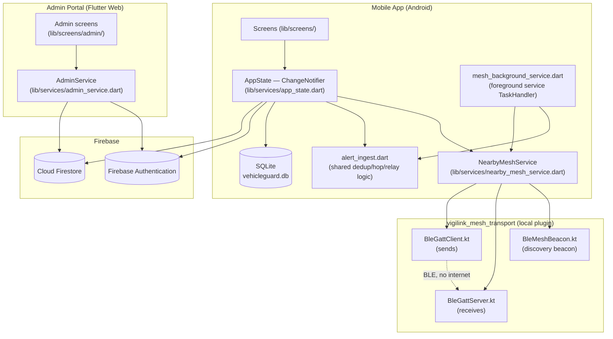
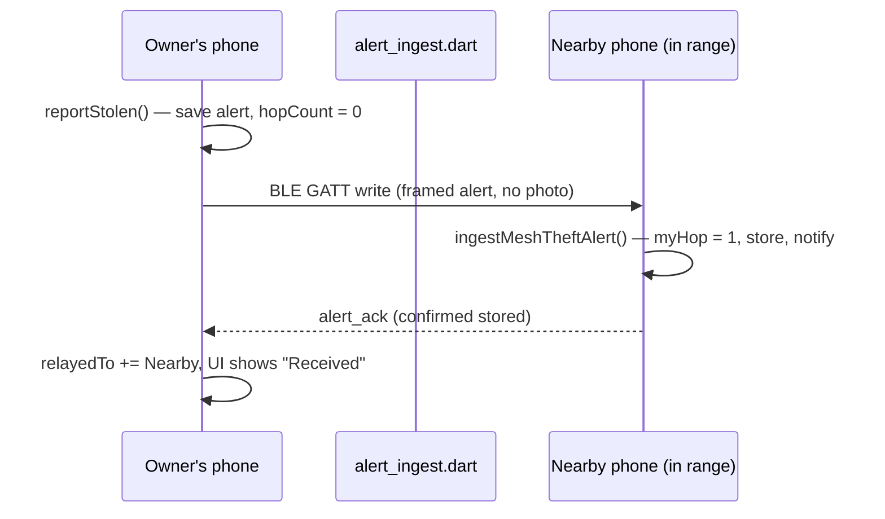
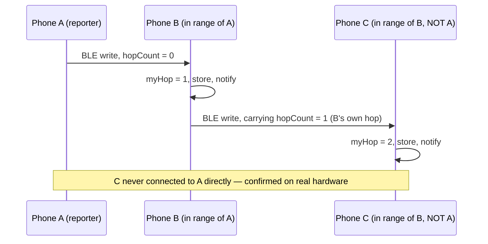
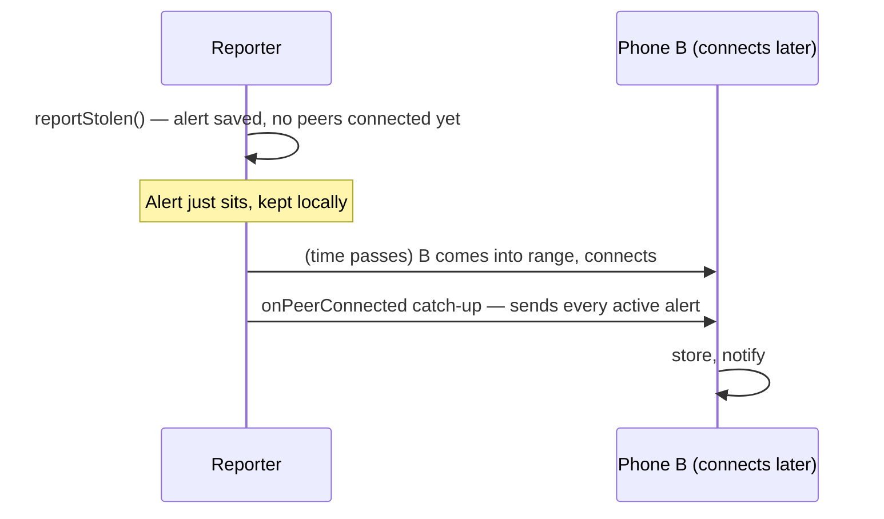
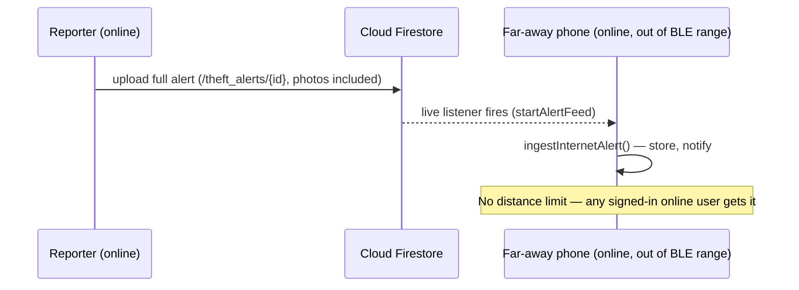
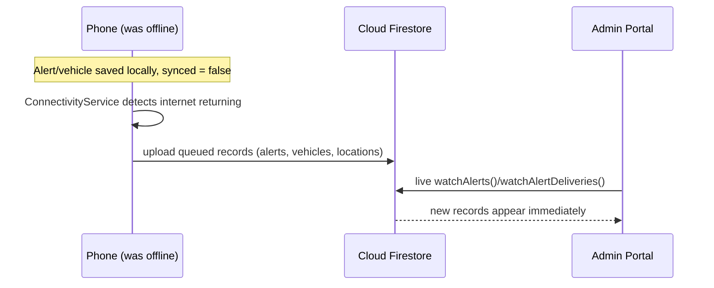
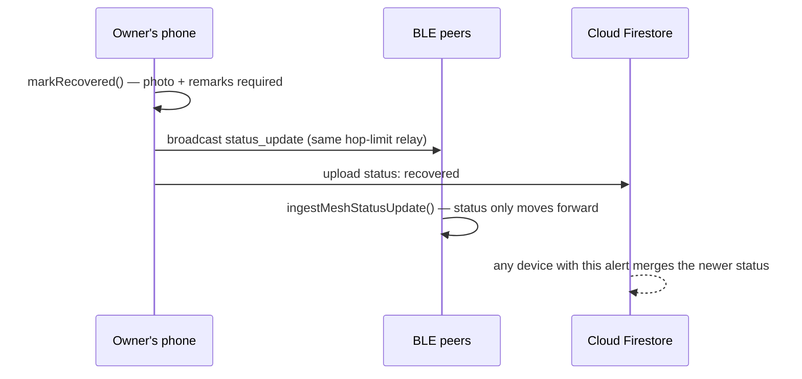

# VIGILINK — Capstone Defense Study Guide (REVIEWER.md)

**Real-Time Vehicle Theft Monitoring and Alert System Using Ad Hoc Networks**
Caraga State University · Cindy A. Francas & Cedric Michael Uy

This guide exists so we can explain, in the defense, how VIGILINK works, where
each feature lives in the code, and how the features connect. Every claim here
was checked against the actual source files in this repository, not against
the manuscript or memory. Where something could not be confirmed from the
code, it says **TODO: confirm** instead of guessing.

---

## Table of Contents

1. [VIGILINK in 30 Seconds](#1-vigilink-in-30-seconds)
2. [System Map](#2-system-map)
3. [Feature-by-Feature Breakdown](#3-feature-by-feature-breakdown)
4. [End-to-End Flows](#4-end-to-end-flows)
5. [Data Model](#5-data-model)
6. [Key Numbers to Remember](#6-key-numbers-to-remember)
7. [Likely Panel Questions and Answers](#7-likely-panel-questions-and-answers)
8. [Known Limitations](#8-known-limitations)
9. [Glossary](#9-glossary)

---

## 1. VIGILINK in 30 Seconds

Vehicle theft alerts that rely only on the internet or cellular signal can
fail exactly when they're needed most — in dead zones, during network
outages, or when a thief disables anything connected. VIGILINK solves this by
having the victim's phone broadcast a stolen-vehicle alert directly to nearby
registered phones over Bluetooth Low Energy (BLE) — no internet required for
that path at all. At the same time, it also uploads the alert to Cloud
Firestore, so any logged-in user anywhere with internet gets it too,
regardless of distance. A vehicle's "safe zone" (geofence) is watched
automatically, so if it moves without the owner reporting it, the system
files the theft report by itself. Nearby phones that catch the alert relay it
further to other phones out of the original sender's own range — true
multi-hop, offline, device-to-device delivery.

---

## 2. System Map



| Component | File(s) | Responsibility |
|---|---|---|
| Mobile app screens | `lib/screens/*.dart` | Everything the vehicle owner/nearby user sees and taps |
| `AppState` | `lib/services/app_state.dart` | Central coordinator: auth, vehicles, alerts, geofence, sightings, notifications, logs |
| BLE mesh plugin (Dart side) | `lib/services/nearby_mesh_service.dart`, `packages/vigilink_mesh_transport/lib/vigilink_mesh_transport.dart` | Dart-facing API for the ad hoc mesh |
| BLE mesh plugin (native side) | `packages/vigilink_mesh_transport/android/.../meshtransport/*.kt` | Real BLE GATT advertise/scan/connect/send on Android |
| Shared alert logic | `lib/services/alert_ingest.dart` | Dedup, hop-count, relay — used by both foreground and background |
| Foreground service | `lib/services/mesh_background_service.dart` | Keeps the mesh + Firestore feed alive while backgrounded |
| SQLite | `lib/services/database_service.dart` | Local offline-first cache (`vehicleguard.db`, schema v8) |
| Firebase Authentication | `lib/services/firebase_auth_service.dart` | Sign-up, sign-in, email verification, Google sign-in |
| Cloud Firestore | `lib/services/firebase_sync_service.dart` | Cloud database: profiles, vehicles, alerts, sightings |
| Web Admin Portal | `lib/admin_main.dart`, `lib/screens/admin/*.dart`, `lib/services/admin_service.dart` | Separate web build for approvals and monitoring |

### 2.5 Tech Stack

| Layer | Technology | Version (pubspec.yaml / Gradle) | Why we used it |
|---|---|---|---|
| Language & framework | Dart / Flutter | Dart SDK `>=3.6.0 <4.0.0` | One codebase for the phone app; Flutter Web reuses it for the Admin Portal |
| Admin Portal | Flutter Web | same Flutter SDK, built with `-t lib/admin_main.dart` | A second, Android-plugin-free entry point so the admin side runs in any browser |
| Native ad hoc layer | Kotlin | — (part of the Android Gradle project, no separate version pin) | `BluetoothGattServer`/`BluetoothGatt` are native Android APIs — not reachable from Dart alone |
| Ad hoc communication | Bluetooth Low Energy — GATT (data) + advertise/scan (discovery beacon) | — (raw AOSP `android.bluetooth.*` APIs) | Works with zero internet and no Google Play Services in the data path |
| Backend / cloud | Firebase Authentication, Cloud Firestore | `firebase_auth: ^5.3.1`, `cloud_firestore: ^5.4.4`, `firebase_core: ^3.6.0` | Managed auth + real-time database with no backend server to run ourselves |
| Local storage | SQLite (`sqflite`), `shared_preferences` | `sqflite: ^2.3.3+1`, `shared_preferences: ^2.2.2` | Offline-first cache; small flags (lockout counters, license cache) |
| Background execution | `flutter_foreground_task` | `^9.1.0` | Keeps the mesh and the Firestore alert feed alive after Home/Back |
| Location & maps | `geolocator`, `flutter_map` + `latlong2` | `^11.0.0`, `^8.3.0` / `^0.9.1` | GPS fix + Haversine distance; OpenStreetMap tiles for the proximity/admin map |
| Notifications | `flutter_local_notifications` | `^17.1.2` | Real local Android notifications (not simulated) |
| State management | `provider` | `^6.1.1` | One `ChangeNotifier` (`AppState`) read by every screen |
| Messaging (receive side) | `firebase_messaging` | `^15.1.3` | Registered for FCM; no server currently sends pushes — see §8 |
| Other key packages | `permission_handler` (`^11.3.0`), `connectivity_plus` (`^6.0.5`), `image_picker` (`^1.1.2`), `google_sign_in` (`^6.2.1`), `intl` (`^0.19.0`) | — | Runtime permissions, online/offline detection, camera/gallery capture, "Continue with Google", date formatting |
| Tools | Android Studio / VS Code, Firebase Console | — | Development IDEs; Firebase project management, and the only place an admin account can be created |
| Target platform | Android 10+ | `minSdk = 29` (`android/app/build.gradle.kts`); `compileSdk`/`targetSdk` are not hardcoded — they come from the installed Flutter SDK's own `flutter.compileSdkVersion`/`flutter.targetSdkVersion` defaults (**TODO: confirm** the exact resolved number for the Flutter version used to build the submitted APK) | Matches the manuscript's Chapter 3 hardware requirement |

**Why Flutter and Firebase?**
- One Dart codebase builds both the Android app and (via a second entry point) the web Admin Portal, without maintaining two separate languages/projects.
- Firebase gives us managed authentication and a real-time database with no backend server to design, host, or secure ourselves — appropriate for a capstone's scope and timeline.
- `provider` with a single `AppState` keeps "what the app knows" in one place that's easy to explain and demo in a defense — every screen updates from one `notifyListeners()` call.

**Why BLE instead of Wi-Fi Direct?**
- An earlier version used raw BLE only for *discovery* and native Wi-Fi Direct (`WifiP2pManager`) for the actual connection and data transfer.
- Real multi-phone testing showed Android's own Wi-Fi Direct group-formation negotiation failing at the OS/radio level on the test hardware — connections forming and dying in under a second. This was confirmed by direct code and log audit to be an OS-level issue, not an app bug.
- BLE GATT has no equivalent "group formation" stage to fail — a BLE central either connects to a peripheral's GATT server or it doesn't — so replacing Wi-Fi Direct with BLE GATT end-to-end removed that whole failure mode. This is now confirmed working on real hardware, including genuine multi-hop relay.

---

## 3. Feature-by-Feature Breakdown

### 3.1 Registration, email verification, and admin approval

**What it does:** A new user creates an account, takes photos of their driver's
license (front and back), and the account can only sign in after an admin
reviews and approves it.

**Where in the code:**
- `lib/screens/s2_s3_auth_screens.dart` → `RegisterScreen._submit()`
- `lib/services/app_state.dart` → `AppState.submitRegistration(...)`
- `lib/services/firebase_sync_service.dart` → `submitProfileForApproval(...)`
- `lib/screens/admin/admin_approvals.dart` → `ApprovalsTab`

**How it works:**
1. User fills in name, email, password, and captures the license front/back (`LicenseCaptureSection`).
2. `RegisterScreen._submit()` validates the form, then calls `AppState.submitRegistration(...)`.
3. `submitRegistration` creates the Firebase sign-in, checks the full-name registry for duplicates, claims the plate, uploads the vehicle + OR/CR + license photos, then writes the profile document with `approvalStatus: 'pending'`.
4. The user is routed to `AwaitingApprovalScreen`, which listens live to their own approval status.
5. An admin opens the **Approvals** tab, reviews all four photos, ticks a four-point checklist, then approves or rejects.
6. Approval flips `approvalStatus` to `'approved'` in Firestore; the Awaiting screen reacts immediately and signs the user in (if their email is also verified).

```dart
// lib/services/firebase_sync_service.dart
Future<void> submitProfileForApproval(UserModel user) =>
    _firestore.collection('users').doc(user.id).set({
      ...user.toMap(),
      'approvalStatus': 'pending',
      'submittedAt': DateTime.now().toIso8601String(),
    }, SetOptions(merge: true)).timeout(_cloudTimeout);
```

**Connects to:** Firebase Authentication (email verification), Firestore (`/users/{uid}`), the Admin Portal's Approvals tab, vehicle registration (one vehicle is registered in the same form).

**Key rule or limit:** An account with no `approvalStatus` field at all (registered before this feature existed) is treated as already approved. A rejected account's vehicle, documents, and plate/name claims are all deleted so the person can register again with the same email.

---

### 3.2 Login, session, and logout

**What it does:** Signs a user in with email/password or Google, keeps them
signed in across app restarts, and cleans up everything on logout.

**Where in the code:** `lib/services/app_state.dart` → `login()`, `signInWithGoogle()`, `init()` (session restore), `logout()`.

**How it works:**
1. `login(email, password)` checks a login lockout (5 failed attempts locks for 5 minutes, persisted in `shared_preferences`), signs in, then checks email verification → the account's `disabled` flag → approval status (`_approvalGate`) → whether a license is on file (`_licenseGate`).
2. On every app restart, `init()` restores the Firebase session and re-checks the same gates (`_approvalBlocksSession`) before loading data.
3. `logout()` stops everything: GPS watch, geofence timer, mesh, Firestore feeds, presence broadcast, and the foreground service, then clears all in-memory lists.

```dart
// lib/services/app_state.dart — simplified
Future<void> logout() async {
  await _mesh.stop();
  _firebaseSync.stopAlertFeed();
  FlutterForegroundTask.stopService();
  currentUser = null;
  _vehicles.clear();
  _alerts.clear();
  notifyListeners();
}
```

**Connects to:** Firebase Authentication, the foreground service (stopped here, started at successful login), the mesh (stopped here).

**Key rule or limit:** Logout unconditionally stops the foreground service even if it never actually started for that session — safe to call regardless.

---

### 3.3 Vehicle registration

**What it does:** Lets an owner register a vehicle with its plate, make/model,
color, year, OR/CR photos, and the engine/chassis numbers — and register more
than one vehicle.

**Where in the code:**
- `lib/screens/s4_s5_vehicle_home.dart` → `VehicleFormSection`, `RegisterVehicleScreen`
- `lib/services/app_state.dart` → `addVehicle(...)`
- `lib/services/firebase_sync_service.dart` → `claimPlateIfAvailable(...)` (Firestore transaction)

**How it works:**
1. The owner fills in plate, body type, model, color, year, engine/chassis numbers, and takes OR + CR photos (`VehicleFormSection.collectDraft()` returns a `VehicleDraft`, or `null` with an inline error if anything's missing).
2. `AppState.addVehicle(...)` normalizes the plate (`normalizedPlate`) and refuses a second vehicle with the same plate already on this account.
3. `claimPlateIfAvailable` runs as a Firestore transaction — reads the current claim, decides, and writes atomically, so two people can't claim the same plate at the same instant.
4. OR/CR photos upload, then the vehicle record saves locally (SQLite) and to Firestore.

```dart
// lib/services/firebase_sync_service.dart — the atomic part
return _firestore.runTransaction((tx) async {
  final doc = await tx.get(_firestore.collection('plates').doc(key));
  if (doc.exists && doc.data()?['ownerId'] != ownerId) return false;
  tx.set(doc.reference, {'ownerId': ownerId, 'plate': plate});
  return true;
});
```

**Connects to:** Registration (one vehicle is registered inline during sign-up), the geofence feature (set per vehicle), theft reporting (one report per vehicle at a time).

**Key rule or limit:** Plate uniqueness is enforced by a Firestore transaction (hard guarantee). Full-name uniqueness elsewhere in the app is a plain read-then-write — best effort, not atomic (see §8).

---

### 3.4 Geofence (boundary setting and violation detection)

**What it does:** The owner draws a safe-zone radius around the vehicle's
parked location. If the phone standing in for the vehicle moves outside that
radius, the system automatically files a theft report.

**Where in the code:**
- `lib/screens/s6_s7_s8_geofence_report.dart` → `GeofenceScreen`
- `lib/services/app_state.dart` → `setVehicleGeofence(...)`, `_checkGeofencesFresh()`, `_checkGeofences()`
- `lib/services/location_service.dart` → `distanceMeters()` (Haversine)

**How it works:**
1. Owner sets a radius and a center point on `GeofenceScreen` → `AppState.setVehicleGeofence(id, radius, {active, centerLat, centerLng})`.
2. Every 15 seconds, `_checkGeofencesFresh()` asks GPS for a fresh fix, then calls `_checkGeofences()`.
3. `_checkGeofences()` computes the Haversine distance from the vehicle's saved center to the device's own current GPS position, for every vehicle with an active geofence.
4. Outside the radius, for the first time: calls `reportStolen(vehicleId, ..., trigger: AlertTrigger.geofenceViolation)` automatically. Within 20 meters of the edge: shows a one-time "Approaching Safe Zone" warning instead.

```dart
// lib/services/app_state.dart — the actual check
final dist = LocationService.distanceMeters(
  v.geofenceCenterLat!, v.geofenceCenterLng!, currentLat!, currentLng!);
if (dist > v.geofenceRadius) {
  await reportStolen(v.id, 'Automatic geofence boundary violation...',
      trigger: AlertTrigger.geofenceViolation);
}
```

**Connects to:** Theft reporting (triggers it automatically), location services (GPS), and — importantly — whichever *device* is currently logged in and has monitoring armed, since the check uses that device's own GPS as the vehicle's location (there is no separate vehicle-tracking hardware).

**Key rule or limit:** Location-based only, using the Haversine formula — no separate hardware tracker. The check is purely GPS distance vs. radius; it is not aware of roads, buildings, or anything else. `monitoringArmed` (whether this device's own geofence check runs at all) is a local, in-memory, per-device toggle that is **not** synced across devices and resets to `true` on every app restart.

---

### 3.5 Report a stolen vehicle (manual)

**What it does:** The owner reports a vehicle stolen at any time, with
required photo evidence and optional remarks; the app also shows local
emergency hotline numbers.

**Where in the code:**
- `lib/screens/s6_s7_s8_geofence_report.dart` → `ReportStolenScreen._confirm()`
- `lib/services/app_state.dart` → `reportStolen(vehicleId, notes, {trigger, photoBytes})`

**How it works:**
1. Owner attaches photo evidence and optional notes on `ReportStolenScreen`.
2. `reportStolen()` throws a `StateError` if the vehicle is already marked stolen (one active report at a time).
3. It marks the vehicle `stolen`, builds a `TheftAlert` (with a real GPS fix, or a flagged placeholder if GPS is unavailable), saves it locally, writes a `LocationRecord`, fires a local notification, and starts the broadcast (BLE mesh + Firestore upload) in parallel.

**Connects to:** BLE broadcasting (3.6), Firestore delivery (3.9), alert history/logging (3.15).

**Key rule or limit:** The manuscript's FR-12 requires exactly 3 photos for a manual report (enforced by the report screen before calling `reportStolen`). An automatic geofence-triggered report has no report form and so carries no photo. Hotline numbers are shown for the user to call manually — VIGILINK does not file a police report automatically (see the README's Scope and Limitations).

---

### 3.6 BLE ad hoc broadcasting — discovery, GATT, framing, acknowledgment

**What it does:** Sends the alert directly to nearby phones over Bluetooth Low
Energy, with zero internet dependency.

**Where in the code:** `packages/vigilink_mesh_transport/android/.../meshtransport/`:
`BleMeshBeacon.kt` (discovery), `BleGattServer.kt` (receive), `BleGattClient.kt`
(send), `BleFraming.kt` (message framing), `VigilinkMeshTransportPlugin.kt`
(orchestration) — wrapped on the Dart side by `lib/services/nearby_mesh_service.dart`.

**How it works:**
1. Every phone runs **both** BLE roles at once: a `BluetoothGattServer` (`BleGattServer.kt`) to receive, and it opens a fresh `BluetoothGatt` client connection (`BleGattClient.kt`) per send.
2. Discovery is a separate, lightweight presence beacon (`BleMeshBeacon.kt`) — pure advertise/scan, a service UUID plus a 4-byte token. It never carries alert data, only "a VIGILINK node is nearby."
3. When sending, the alert is framed (`BleFraming.kt`: a 4-byte length prefix + an 8-character sender token + the JSON payload) and written as one or more GATT characteristic writes, chunked to whatever MTU is negotiated.
4. The receiver sends back an `alert_ack` message once it has actually *stored* the alert — so a successful radio write is never confused with confirmed delivery.

```kotlin
// BleFraming.kt — the wire format, simplified
fun encode(senderToken: String, payload: ByteArray): ByteArray {
    val total = TOKEN_LEN + payload.size
    // 4-byte big-endian length, then the 8-char token, then the JSON payload
    ...
}
```

**Connects to:** Multi-hop relaying (3.7), store-carry-forward (3.8), alert notifications (3.12).

**Key rule or limit:** No Google Play Services anywhere in this path — raw AOSP Bluetooth APIs only, so there is nothing in it that could depend on an internet connection.

---

### 3.7 Multi-hop relaying

**What it does:** Lets an alert reach a phone that is out of range of the
original reporter, by passing through other phones in between.

**Where in the code:** `lib/services/alert_ingest.dart` → `ingestMeshTheftAlert(...)`, constant `alertMeshHops`.

**How it works:**
1. A fresh alert starts at `hopCount = 0` on the original reporter's own device.
2. A receiving phone computes `myHop = receivedHop + 1` before storing it.
3. If `myHop < alertMeshHops` (5), it forwards the alert to every other connected peer, carrying `myHop` (the next receiver adds 1 itself). At `myHop == 5`, the phone keeps and shows the alert but stops relaying it further.
4. Duplicate filtering: the alert ID is checked against an in-memory `Set` (closes a same-isolate race) and then `DatabaseService.alertExists(id)` (SQLite-backed, authoritative, survives the foreground/background hand-off) before it's stored or relayed at all.

```dart
// lib/services/alert_ingest.dart — simplified
final myHop = receivedHop + 1;
if (!_inFlightAlertIds.add(id)) return null;       // in-flight guard
if (await db.alertExists(id)) return null;          // SQLite guard
...
if (myHop < alertMeshHops) {
  await NearbyMeshService.instance.broadcast(forwardMsg, excludeEndpointId: fromEndpointId);
}
```

**Connects to:** BLE broadcasting (3.6), store-carry-forward (3.8), the background service (both the foreground `AppState` and the background `mesh_background_service.dart` call this exact same function).

**Key rule or limit:** **Hard cap of 5 hops.** This prevents an alert from circulating forever in a mesh with loops. This flipped from an earlier descending-TTL design (see `Progress.md`'s 2026-11-05 entry) to counting *up* from 0, because the old design made the reporter always show "Hop 0" and the very first receiver show "Hop 5," which read backwards.

---

### 3.8 Store-carry-forward

**What it does:** A phone that has an active alert, but currently has no
connected peer, simply keeps it and forwards it automatically the next time
it connects to someone new — even much later.

**Where in the code:** `lib/services/app_state.dart` and `lib/services/mesh_background_service.dart`, both inside their `onPeerConnected` callback; the Alert Received screen's manual **Force Relay** button (`lib/screens/s9_s10_s11_alerts_map.dart` → `AppState.forceRelayAlert`).

**How it works:**
1. When a new peer connection is confirmed, the device sends that peer every alert it currently has marked active.
2. This only fires for a **genuinely new** connection — it's gated against re-firing for every redundant reconfirmation of an already-connected peer (a real bug here, fixed after real-device testing showed the same alert being resent repeatedly to one already-connected phone).
3. The manual **Force Relay** button lets a user explicitly re-trigger this same send path on demand, instead of waiting for a new peer to connect.

**Connects to:** Multi-hop relaying (3.7) — this is what makes multi-hop work even when not every phone is connected to every other phone *at the same time*.

**Key rule or limit:** Only alerts with `status == active` are forwarded this way. A newly-connected peer that already has the alert simply discards the duplicate.

---

### 3.9 Internet delivery through Cloud Firestore

**What it does:** Delivers the alert to every signed-in user with internet,
with no distance limit at all — a completely separate, parallel path to BLE.

**Where in the code:** `lib/services/firebase_sync_service.dart` → `startAlertFeed(...)`; `lib/services/alert_ingest.dart` → `ingestInternetAlert(...)`.

**How it works:**
1. `_syncSoonIfOnline()` uploads the full alert (photos included) to `/theft_alerts/{alertId}`.
2. Every other signed-in, online phone has a live Firestore listener (`startAlertFeed`, filtered to the last 24 hours) that fires on any matching document.
3. `ingestInternetAlert` stores a brand-new active alert regardless of how far away that phone is — the old distance filter was removed specifically so internet delivery matches the mesh's own "reach everyone" goal.

**Connects to:** Theft reporting (3.5), offline-to-online sync (3.10), photo delivery (3.16).

**Key rule or limit:** No distance filter. Only an alert still `active` (not already recovered/resolved elsewhere) is raised as new.

---

### 3.10 Offline-to-online sync

**What it does:** Any record (alert, vehicle, sighting, location) saved while
offline automatically uploads once the device regains internet.

**Where in the code:** `lib/services/app_state.dart` → `_onConnectivityChanged(online)`; `lib/services/connectivity_service.dart`.

**How it works:**
1. Every local write sets `synced: false` in SQLite.
2. `ConnectivityService.listen(...)` fires `_onConnectivityChanged(true)` the moment the OS reports connectivity returning.
3. This runs a sync pass (alerts, vehicles, sightings, locations) and retries automatically every 30 seconds if anything is still unsynced.

**Connects to:** Every feature that writes local data (vehicle registration, theft reports, sightings, recovery updates).

**Key rule or limit:** Alert uploads use a merge rule — only the original reporter can replace the whole document; a relaying device only ever updates `hopCount` and `relayedTo`, and a status can only move forward (active → recovered → resolved), never backward.

---

### 3.11 Background operation

**What it does:** Keeps the mesh and the Firestore alert feed running even
while the app is backgrounded, the Activity is destroyed, or the phone is
locked.

**Where in the code:** `lib/services/mesh_background_service.dart` (the `TaskHandler`), `lib/services/app_state.dart` → `_handOffMeshToBackground()`, `_reclaimMeshFromBackground()`, `_handoffDelay`; `lib/utils/picker_guard.dart`; `lib/services/notification_service.dart` → `_onNotificationTapped`.

**How it works:**
1. The foreground service itself starts once at login and runs until logout — not only when backgrounded.
2. Only *mesh ownership* hands off: when the app is backgrounded for more than 15 seconds (`_handoffDelay`, a debounce so a quick Home-and-back doesn't trigger a reconnect), the main isolate stops its own mesh/Firestore feeds and the background `TaskHandler` starts its own.
3. The hand-off is deliberately skipped while a camera/photo picker is open (`isPickerOpen`, `picker_guard.dart`) — Android reports the app as "paused" the instant a picker opens, which would otherwise look identical to the user actually leaving.
4. Tapping a notification opens the specific alert it's about, even from a fresh relaunch (`_onNotificationTapped` → `_openAlert` → pushes `/alert-received`).

**Connects to:** BLE broadcasting and Firestore delivery (both keep running through this), alert notifications (3.12).

**Key rule or limit:** Confirmed working via a real test — app fully backgrounded, phone locked, and a notification still arrived. Hand-off delay is 15 seconds; stops immediately and unconditionally on logout.

---

### 3.12 Alert notifications

**What it does:** Shows a local device notification the moment an alert is
received, in both the foreground and the background.

**Where in the code:** `lib/services/notification_service.dart` → `show(title, body, {payload})`, `init()`.

**How it works:**
1. `NotificationService.init()` creates the `vehicleguard_alerts` Android notification channel.
2. `show(...)` is called from `alert_ingest.dart` the moment an alert is successfully stored (mesh or internet path), in whichever isolate (foreground `AppState` or background `TaskHandler`) actually processed it.
3. The alert's own ID is passed as the notification's `payload`, so tapping it opens that exact alert.

**Connects to:** Both delivery paths (3.6/3.9), background operation (3.11).

**Key rule or limit:** `initFcm()` registers for Firebase Cloud Messaging, but no server currently sends FCM pushes (see §8) — a closed app that was never opened at all still won't be woken by a push; it relies on the foreground service staying alive instead.

---

### 3.13 Sightings

**What it does:** Lets a nearby user who spots a flagged vehicle send a
message (and optional photo/GPS) to the vehicle's owner.

**Where in the code:** `lib/screens/s16_sightings.dart` → `ReportSightingScreen`, `AlertSightingsScreen`; `lib/services/app_state.dart` → `submitSighting(...)`; `lib/services/alert_ingest.dart` → `ingestMeshSighting(...)`.

**How it works:**
1. Reporter fills in a message, when they saw it, and optionally a photo and GPS fix.
2. `submitSighting` saves it locally first, uploads the full copy (photo + reporter phone number) to `/sightings`, and — if mesh peers are connected — also broadcasts a text-only copy (no photo, no phone number) with a 5-hop limit, same as alerts.
3. A receiving phone keeps a sighting only if it belongs to the vehicle's own owner; otherwise (mesh path) it just relays the text onward.

**Connects to:** The same BLE mesh and Firestore paths alerts use; the vehicle owner's `AlertSightingsScreen`.

**Key rule or limit:** The mesh copy never carries the photo or the reporter's phone number — same size/privacy reasoning as alert photos.

---

### 3.14 Recovery update

**What it does:** Lets the owner mark a stolen vehicle recovered, with
required proof, and notifies other devices that already have the alert.

**Where in the code:** `lib/screens/s12_s13_s14_status_notif_profile.dart` → `UpdateStatusScreen`; `lib/services/app_state.dart` → `markRecovered(alertId, {remarks, recoveryPhotoBytes})`.

**How it works:**
1. Owner provides exactly one recovery photo and a required remark on how/where it was found.
2. `markRecovered` sets the alert's status to `recovered`, stores the proof as `recoveryPhotos`/`recoveryRemarks` (kept separate from the original report's own `notes`), and sets the vehicle back to `active` so it can be reported again later.
3. The status change broadcasts over the mesh (`status_update` message type) and uploads to Firestore, where it merges into any copy another device already has — statuses only ever move forward, so a stale copy can never downgrade a newer one.

**Connects to:** Theft reporting (reopens the vehicle for a future report), multi-hop relay (the status update itself relays, same hop-limit logic).

**Key rule or limit:** Both a photo and a remark are required together — enforced by `UpdateStatusScreen` before `markRecovered` is ever called.

---

### 3.15 Alert history, system logs, and performance data

**What it does:** Lets anyone see every alert they've received and a full
technical trail of what the app did, including delivery delay and hop count.

**Where in the code:** `lib/screens/s9_s10_s11_alerts_map.dart` → `AlertHistoryScreen`; `lib/screens/s12_s13_s14_status_notif_profile.dart` → `SystemLogsScreen`; `lib/services/app_state.dart` → `_logAlertDelivery(alert, {via})`.

**How it works:**
1. `_logAlertDelivery` is called exactly once, the first time a genuinely new alert is stored (whether it arrived by mesh or internet). It computes `delayMs = receivedAt − alert.timestamp` (using the receiving phone's own clock against the sender's recorded send time).
2. It writes one `SystemLog` entry with the plate, delay, delivery route, and hop count, and separately uploads the same record to `/alert_deliveries` for the Admin Portal.
3. `SystemLogsScreen` shows the last 300 log entries stored locally.

**Connects to:** Both delivery paths (whichever one arrives first is what gets timed), the Admin Portal's Live Activity tab (which averages every delivery record).

**Key rule or limit:** The delay is only as accurate as the two phones' clocks agree — if the sender's and receiver's clocks differ, the recorded delay is off by that same amount.

---

### 3.16 Photos — why they never travel over BLE

**What it does:** Keeps alert data small enough for a reliable multi-hop BLE
relay, while still letting the real photo reach every device eventually.

**Where in the code:** `lib/services/app_state.dart` → `_alertWireMessage(alert)`; `lib/services/alert_ingest.dart` → `ingestInternetAlert(...)`.

**How it works:**
1. The BLE wire message strips the `photos` field entirely and instead carries a boolean `hasPhotoEvidence` flag — so a receiving phone can tell "a photo exists" without needing the actual bytes.
2. The real photo bytes travel only through the Firestore upload of the full alert document.
3. When a device that received the alert via mesh (no photo) later gets internet back, its Firestore alert-feed listener re-delivers the full document — `ingestInternetAlert` now backfills the missing `photos` field into the already-stored alert, even if the alert's status hasn't also changed (a real bug where this silently never happened otherwise was found and fixed — see `Progress.md`).

**Connects to:** BLE broadcasting (3.6), internet delivery (3.9), offline-to-online sync (3.10).

**Key rule or limit:** A photo can be up to roughly 450 KB — far too large for a reliable relay across several BLE hops. Exactly 3 photos are required for a manual report (see 3.5).

---

### 3.17 Location — GPS, broadcast radius, and Haversine

**What it does:** Clarifies two different, easily confused things: *where*
the alert says the vehicle was, versus *who* actually receives it over BLE.

**Where in the code:** `lib/services/location_service.dart` → `getCurrentPosition()`, `distanceMeters()`.

**How it works:**
1. The alert's recorded location is the **reporting phone's own GPS fix** at the moment of reporting — available even with zero internet, since GPS itself doesn't need a data connection.
2. Each receiving phone independently computes its own distance to that recorded location using the Haversine great-circle formula (`Geolocator.distanceBetween`).
3. The **BLE broadcast radius** is a completely separate thing — it's simply how far that phone's own Bluetooth radio physically reaches (roughly 10–100 m, depending on hardware and surroundings like walls or interference). It decides *who is close enough to receive the alert directly*, not what location the alert reports.

**Connects to:** Theft reporting (where the location comes from), geofence (the same Haversine function), BLE broadcasting (what the radius actually limits).

**Key rule or limit:** The app never fabricates GPS coordinates — if no fix is available, the alert is flagged rather than given a fake location.

---

### 3.18 Admin Portal — Accounts, Vehicles, Live Activity, Map

**What it does:** A separate, web-only dashboard for admins to approve
registrations and monitor the whole system.

**Where in the code:** `lib/admin_main.dart`, `lib/screens/admin/admin_dashboard.dart`, `lib/services/admin_service.dart`.

**How it works (per tab):**
- **Accounts** (`admin_accounts.dart` → `AccountsTab`) — reads `AdminService.fetchAllUsers()`: every approved account, vehicle count, license-on-file flag; lets an admin suspend/restore (`setDisabled`) or permanently remove (`removeUser`) an account.
- **Vehicles** (`admin_vehicles.dart` → `VehiclesTab`) — reads `fetchAllVehicles(users)`: every registered vehicle plus its OR/CR photos.
- **Approvals** (`admin_approvals.dart` → `ApprovalsTab`) — live stream from `watchPendingRegistrations()`: pending registrations, oldest first.
- **Live Activity** (`admin_monitoring.dart` → `LiveActivityTab`) — four combined live feeds via `AdminMonitorFeed`: `watchAlerts()`, `watchSightings()`, `watchDevices()`, `watchAlertDeliveries()`.
- **Map** (`admin_monitoring.dart` → `MonitorMapTab`) — plots device/alert positions using the same `AdminMonitorFeed`.

**Connects to:** Registration/approval (3.1), every delivery path (Live Activity reads the same `/alert_deliveries` records §3.15 writes).

**Key rule or limit:** The Admin Portal never imports `AppState` or `DatabaseService` — it's a deliberately separate build (`flutter build web -t lib/admin_main.dart`) so it stays small and buildable for the web, since `sqflite` and the Bluetooth mesh plugin have no web implementation.

---

### 3.19 Security and privacy

**What it does:** Controls who can see what — license photos, OR/CR, and
what a nearby stranger relaying your alert can actually read.

**Where in the code:** `lib/services/firebase_auth_service.dart`, `lib/services/admin_service.dart`, `lib/services/alert_ingest.dart` (what the BLE wire message does and doesn't include).

**How it works:**
1. All credential handling (passwords, tokens) happens inside Firebase Authentication — this app never stores a password itself.
2. Firestore document access (license photos, OR/CR, profile fields like `approvalStatus`/`role`/`disabled`) is restricted by Firestore Security Rules, published directly in the Firebase Console. **This repository does not contain a `.rules` file** — the intended rule blocks are documented in prose in `Progress.md` (the 2026-10-05 entry) rather than verifiable against an actual rules file here. Per that documentation: only the owner and an admin can read a user's license/OR/CR documents; an owner cannot change their own `approvalStatus`, `role`, or `disabled` field.
3. A phone merely *relaying* an alert over BLE only ever sees the text details (plate, model, color, notes, `hasPhotoEvidence`) — never the actual photo bytes, and a sighting's mesh copy strips the reporter's phone number too.

**Connects to:** Registration/approval (who can even become an admin — only by hand in the Firebase Console, no in-app path), photos (3.16).

**Key rule or limit:** **TODO: confirm** — the actual Firestore rules text was not found anywhere in this repository; everything stated above about what the rules enforce is sourced from `Progress.md`'s prose description, not independently verified against a rules file.

---

## 4. End-to-End Flows

### A. Report → direct BLE delivery to a nearby device


A phone within BLE range gets the alert almost immediately, with no internet
involved at any point.

### B. Report → multi-hop relay through a middle device



### C. No internet + no nearby device → store-carry-forward → later forwarded



### D. Internet available → Firestore delivery to a far device



### E. Offline device reconnects → records sync → appear on the Admin Portal



### F. Vehicle marked recovered → update reaches other devices



---

## 5. Data Model

### Main models (`lib/models/models.dart`)

| Model | Key fields | Purpose |
|---|---|---|
| `UserModel` | `id`, `name`, `email`, `phone`, `role` (`owner`/`admin`), `deviceId`, `createdAt?` | Account profile. `approvalStatus`, `rejectionReason`, `disabled` live only in Firestore, not on this model |
| `VehicleModel` | `id`, `ownerId`, `plate`, `model`, `color`, `type`, `yearModel`, `engineNumber`, `chassisNumber`, `status`, `geofenceRadius`, `geofenceActive`, `geofenceCenterLat/Lng`, `lat`, `lng`, `createdAt?` | A registered vehicle |
| `TheftAlert` | `id`, `vehicleId`, `userId`, `plate`, `model`, `color`, `engineNumber`, `chassisNumber`, `lat`, `lng`, `timestamp`, `trigger`, `status`, `notes`, **`photos: List<String>`** (up to 3, base64), `hopCount`, `relayedTo`, `recoveryPhotos: List<String>`, `recoveryRemarks` | A stolen-vehicle alert |
| `SightingReport` | `id`, `alertId`, `ownerId`, `reporterId`, `reporterName`, `reporterPhone`, `message`, `lat?`, `lng?`, `seenAt`, `sentAt`, `photoB64?` (single photo, not a list) | A nearby user's sighting of a flagged vehicle |
| `AdHocNode` | `id`, `name`, `distance`, `isOnline`, `connectionType` (`wifiDirect`/`ble` — the enum still has an unused `wifiDirect` value left over from the earlier transport, even though nothing sets it anymore), `hopCount`, `relayStatus`, `endpointId?`, `viaInternet` | One mesh peer, for the UI's node list |
| `LocationRecord` | `vehicleId`, `lat`, `lng`, `time`, `synced` | One GPS point recorded at each report |
| `SystemLog` | `tag`, `message`, `type`, `createdAt` | One technical log line |
| `NotifItem` | `id`, `title`, `body`, `type`, `time`, `isRead` | One in-app notification |

### Firestore collections actually in use

| Path | Purpose |
|---|---|
| `/users/{uid}` | Profile, `approvalStatus`, `rejectionReason`, `disabled` |
| `/users/{uid}/vehicles/{vehicleId}` | Vehicle record |
| `/users/{uid}/vehicles/{vehicleId}/documents/{or\|cr}` | OR/CR photos |
| `/users/{uid}/license/{front\|back}` | License photos |
| `/theft_alerts/{alertId}` | Alerts |
| `/sightings/{sightingId}` | Sightings |
| `/presence/{uid}` | Live position, 10-minute window |
| `/plates/{normalizedPlate}` | Cross-account plate uniqueness |
| `/account_names/{normalizedName}` | Full-name uniqueness (best effort) |
| `/removed_accounts/{uid}` | Blocks a removed account from logging back in |
| `/alert_deliveries/{id}` | Delivery-delay records for the Admin Portal |

### SQLite tables actually in use (`vehicleguard.db`, schema v8)

| Table | Purpose |
|---|---|
| `users`, `vehicles` | Local cache of the signed-in account's own data |
| `theft_alerts` | Every alert this phone knows about (column still named `photoB64` in the DB schema even though the model field is now `photos` — **TODO: confirm** whether this is just a historical column name or an actual mismatch worth cleaning up) |
| `alert_logs` | Per-peer relay record for the real mesh |
| `location_history` | GPS points |
| `nodes` | Cached mesh peer list |
| `notifications`, `system_logs` | In-app notifications, diagnostic log (trimmed to 300 rows) |
| `sightings` | Sighting reports |
| `session` | Key-value store (last signed-in user, cached profile photo) |

---

## 6. Key Numbers to Remember

| Number | Meaning | Defined in |
|---|---|---|
| **5 hops** | Max relay distance before a phone stops forwarding an alert further | `lib/services/alert_ingest.dart` — `alertMeshHops` |
| **3 photos** | Required for a manual theft report | Enforced in `lib/screens/s6_s7_s8_geofence_report.dart` (`ReportStolenScreen`) |
| **Android 10+** | Minimum supported OS version | `android/app/build.gradle.kts` — `minSdk = 29` |
| **BLE only** | No Wi-Fi Direct anywhere in the current mesh | `packages/vigilink_mesh_transport/` |
| **30 seconds** | Per-attempt BLE GATT send/connect timeout | `BleGattClient.kt` — `OPERATION_TIMEOUT_MS` |
| **6 attempts, 2-second gap** | Retry budget for one BLE GATT send (worst case ≈190 s total) | `VigilinkMeshTransportPlugin.kt` — `GATT_MAX_ATTEMPTS`, `GATT_RETRY_GAP_MS` |
| **210 seconds** | How long before giving up waiting for an `alert_ack`, and the matching pending-connection guard window | `lib/services/app_state.dart` — `_alertAckTimeout`; `lib/services/nearby_mesh_service.dart` — the pending-connection timer |
| **15 seconds** | Beacon "lost" timeout (how long with no sighting before a peer is considered gone) | `BleMeshBeacon.kt` — `LOST_TIMEOUT_MS` |
| **15 seconds** | Background hand-off debounce (how long backgrounded before mesh ownership transfers) | `lib/services/app_state.dart` — `_handoffDelay` |
| **15 seconds** | Geofence re-check interval | `lib/services/app_state.dart` — `_checkGeofencesFresh()` |
| **20 meters** | "Approaching safe zone" warning margin | `lib/services/app_state.dart` — `_geofenceNearMarginMeters` |
| **90 seconds** | Mesh watchdog: refreshes radios if nobody's been seen this long | `lib/services/nearby_mesh_service.dart` — watchdog tick |
| **30 seconds** | Mesh watchdog check interval; also the sync-retry interval | `lib/services/nearby_mesh_service.dart`; `lib/services/app_state.dart` |
| **~450 KB** | Max photo size (compressed, resized to 1,600 px) | `lib/widgets/document_photo.dart` — `captureDocumentPhoto` |
| **5 attempts / 5 minutes** | Login lockout | `lib/services/app_state.dart` — `login()` |
| **24 hours** | Firestore alert feed only watches alerts from this recent window | `lib/services/firebase_sync_service.dart` — `startAlertFeed` |
| **100 meters** | Radius for the internet-presence "nearby devices" list | `lib/services/app_state.dart` — `_recomputePresenceNodes()` |

---

## 7. Likely Panel Questions and Answers

1. **How does ad hoc work without internet?**
   Every phone runs raw Android BLE APIs directly — a `BluetoothGattServer` to
   receive and a `BluetoothGatt` client connection to send — with zero Google
   Play Services involved anywhere in that path. There's nothing in it that
   could depend on an internet connection.

2. **Is it really ad hoc, or simulated?**
   Real. Confirmed on actual multi-phone hardware, including true multi-hop
   relay where the last phone was never in the original reporter's own range.
   Nothing about the BLE transport is faked or mocked.

3. **How do you prevent duplicate or infinite alerts?**
   Every alert has a unique ID, checked against an in-memory set and then
   SQLite (`alertExists`) before being stored or relayed — a duplicate is
   logged and dropped. Infinite circulation is prevented by the 5-hop cap.

4. **What if no device is nearby?**
   The alert is simply kept (store-carry-forward) and sent automatically the
   next time any new peer connects, even much later. It's also uploaded to
   Firestore in parallel, so any online user still gets it immediately.

5. **What if the phone is locked or the app is in the background?**
   An Android foreground service keeps the mesh and the Firestore alert feed
   running after Home/Back — confirmed working with the phone fully locked
   and the app not open at all.

6. **Why BLE and not Wi-Fi Direct?**
   An earlier version used Wi-Fi Direct for the actual connection/data
   transfer. Real-device testing showed Android's own Wi-Fi Direct
   group-formation negotiation failing at the OS/radio level — not an app
   bug. BLE GATT has no equivalent negotiation stage to fail.

7. **How is location determined if BLE range is limited?**
   The alert's location is the reporting phone's own GPS fix, which works
   even with zero internet. BLE range only decides who can receive the alert
   directly — it has nothing to do with what location gets reported.

8. **Why aren't photos sent over BLE?**
   A photo can be up to ~450 KB — too large for a reliable multi-hop BLE
   relay. Only text details and a `hasPhotoEvidence` flag travel over BLE;
   the real photo arrives later through Firestore, and now automatically
   backfills into the already-stored mesh alert once that device is online.

9. **How do you prevent false reports?**
   A vehicle can only have one active report at a time (`reportStolen`
   throws if already stolen). Geofence violations only fire once per breach
   (not repeatedly). There's no automatic verification of a manual report's
   truthfulness beyond that — it's the owner's own account reporting it.

10. **How is data secured?**
    Firebase Authentication handles all credentials. Firestore access is
    restricted by security rules published in the Firebase Console
    (documented in `Progress.md`; the rules file itself isn't in this repo —
    **TODO: confirm** if that should change). A phone relaying an alert only
    ever sees text details, never the photo bytes.

11. **What happens on logout?**
    Everything stops: the mesh, the Firestore feeds, GPS watching, presence
    broadcasting, and the foreground service. All in-memory data clears.

12. **How does the admin verify users?**
    Visually. The admin reviews all four required documents (license front,
    license back, OR, CR) against a four-point checklist before Approve
    unlocks. The app itself does not read or verify photo content.

13. **Can it scale to a city?**
    The mesh itself is peer-to-peer and local by nature — it scales the way
    any BLE ad hoc mesh does, by density of nearby registered phones, not by
    a central server. Firestore delivery has no distance limit and scales as
    Firestore itself scales. **TODO: confirm** — no load testing at city
    scale was performed; this is an architectural answer, not a measured one.

14. **What about battery?**
    The foreground service keeps radios active continuously while logged in,
    which does cost battery — this is the tradeoff for reliable background
    delivery. Some Android OEM battery-optimization features can still kill
    the service despite the persistent notification; see §8.

15. **Why was multi-hop sometimes slower than expected?**
    Real BLE radios aren't instant — a single GATT send can need up to 6
    retry attempts (each with a 30-second timeout) to ride out radio
    contention, which is why a send can occasionally take a long time on a
    busy radio. The manual Force Relay button exists partly so a user isn't
    stuck only waiting.

16. **What are the system's limitations?**
    See §8 — no distance-targeted push notifications, geofence/GPS watching
    is still foreground-dependent in a way the mesh/Firestore feed are not,
    Android only, and the Admin Portal runs as a local web build rather than
    a hosted one.

17. **Why two separate Flutter builds (phone app and Admin Portal)?**
    Most of the phone app — SQLite, the BLE mesh, GPS, notifications — is
    Android-only and won't build for the web. The admin build only imports
    Firebase and the admin screens, so it stays small and web-compatible.

18. **How are admin accounts created?**
    Only by hand in the Firebase Console, setting `role: 'admin'` directly on
    that account's Firestore document. There is no in-app way to create or
    promote an admin — an earlier design with a hardcoded admin credential
    was removed for security reasons.

19. **What happens if two phones try to connect at the exact same moment?**
    Each waits a random 250–2,000 ms before requesting a connection, so the
    two requests don't collide.

20. **How do you know the mesh is reliable, not just "it worked once"?**
    It was confirmed across multiple real-device test sessions, including
    direct delivery, true 3-hop relay, and the dashboard correctly syncing
    afterward — documented with dates and evidence in `Progress.md`, not
    a single anecdotal success.

---

## 8. Known Limitations

- **Offline (BLE) delivery still needs devices within range**, directly or
  through relay — it cannot reach a phone with no path at all through any
  connected chain.
- **Multi-hop has real delay.** A single BLE send can take anywhere from
  under a second up to roughly a minute on a contended radio, because of the
  retry budget described in §6.
- **The foreground service stops if the app is force-stopped** by the user or
  killed by aggressive OEM battery optimization, despite the persistent
  notification — this is an Android platform behavior, not something the app
  can fully prevent.
- **Android only.** No iOS build exists; `MultipeerConnectivity` (iOS's BLE
  equivalent) was never implemented.
- **The Admin Portal runs as a local web build** (`flutter run`/`flutter
  build web`) rather than a hosted, publicly reachable deployment.
- **No push notifications to a closed app.** `firebase_messaging` is
  registered for receiving, but no server currently sends FCM pushes — an
  alert only reaches a phone through the internet feed while something
  (the app or the foreground service) is actually running.
- **Geofence/GPS watching is still foreground-dependent** in a way the mesh
  and Firestore feed are not — the background service keeps those two alive,
  but the live GPS watch and geofence breach check still need the app open
  or at least not stopped by Android.
- **Approval is a visual check only.** The admin reviews photos by eye; the
  app does not verify document authenticity.
- **Full-name uniqueness is best effort, not atomic** — unlike plate
  uniqueness, which is a real Firestore transaction.
- **No automated test covers the mesh, Firestore, or the approval flow
  end-to-end** — these need physical phones or a live Firebase project;
  confidence comes from the dated, documented manual testing in `Progress.md`.
- **Firestore security rules are not in this repository** — they're
  published directly in the Firebase Console, with the intended rule text
  only in `Progress.md`'s prose, so nothing in this repo mechanically
  guarantees they match.

---

## 9. Glossary

| Term | Meaning |
|---|---|
| **Ad hoc network** | A network formed directly between devices, with no fixed router or access point in between |
| **MANET / VANET** | Mobile/Vehicular Ad Hoc Network — the general category of network this project implements, using smartphones in place of dedicated vehicle hardware |
| **BLE** | Bluetooth Low Energy — a low-power Bluetooth mode, used here for both discovery and the actual alert data transfer |
| **GATT** | Generic Attribute Profile — the standard way two BLE devices exchange structured data once connected (a "server" that holds data, a "client" that reads/writes it) |
| **Broadcast radius** | How far one phone's BLE radio physically reaches — decides who can receive an alert directly, not what location it reports |
| **Multi-hop** | An alert passing through more than one intermediate device to reach a destination out of the original sender's own range |
| **Hop count** | How many real devices an alert has actually passed through so far, counting up from 0 at the original reporter |
| **Store-carry-forward** | Keeping a message locally and forwarding it later, once a new connection becomes available, instead of requiring an unbroken path to exist right now |
| **Epidemic routing** | The general routing strategy this resembles — a message spreads opportunistically to every peer a device meets, rather than along one fixed route |
| **Foreground service** | An Android mechanism for a background task to keep running (with a persistent notification) without being killed as aggressively as a normal background process |
| **Firestore** | Google's cloud NoSQL document database — this app's only backend server, called directly from the client with no custom backend code |
| **SQLite** | A local, file-based relational database — used here as the phone's offline-first cache (`vehicleguard.db`) |
| **Haversine formula** | A formula for computing the great-circle (straight-line, accounting for Earth's curvature) distance between two GPS coordinates |
| **Geofence** | A virtual boundary around a location; here, around where a vehicle is parked — leaving it, without the owner reporting it, triggers an automatic theft alert |

---

## When This Guide Was Last Checked

Rewritten and reorganized for the capstone defense on **2026-11-13**, verified
directly against `pubspec.yaml`, the Android manifest and Gradle config,
`lib/models/models.dart`, `lib/services/*.dart`, `lib/screens/` (including
`onboarding_screen.dart`, not previously documented), and the native Kotlin
files under `packages/vigilink_mesh_transport/`. Full change history is in
`Progress.md`.
